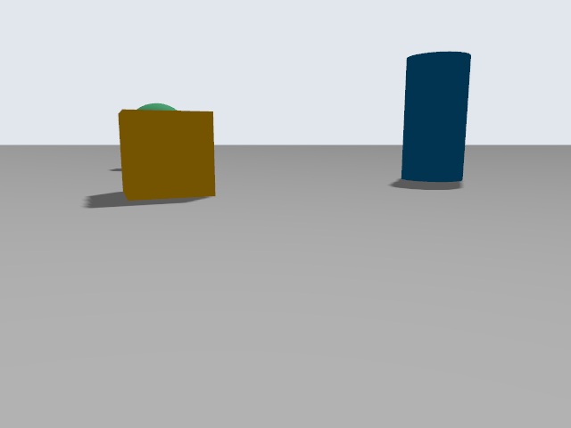
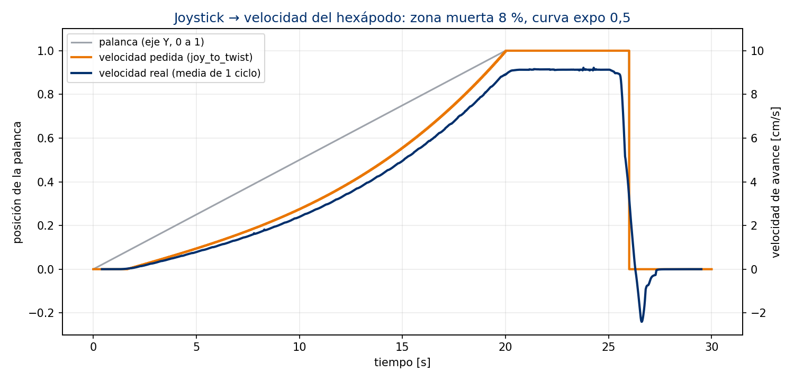

# Hexápodo simulado — Documentación por etapa

Registro de lo que se hizo en cada etapa, por qué y cómo se comprueba. Sirve
para estudiar y para armar la presentación. Las etapas son registro: el
trabajo es continuo. El plan completo está en `docs/plan/plan_ataque.pdf`.

Convención de origen de los datos, igual que en `hexapod_params.xacro`:
**[medido]** por el usuario · **[hoja]** hoja de datos · **[hipótesis]**
estimación propia · **[provisorio]** cota de partida que E8 reemplaza.

---

## E0 — Workspace y parámetros

**Qué se hizo**

- Workspace ROS 2 Jazzy con tres paquetes:

  | Paquete | Tipo | Contenido |
  |---|---|---|
  | `hexapod_description` | ament_cmake | Modelo (URDF/xacro), RViz y launch de visualización |
  | `hexapod_control` | ament_python | Cinemática, marcha y teleoperación (el "cerebro") |
  | `hexapod_bringup` | ament_python | Gazebo, controladores y launch general (desde E3) |

- `hexapod_params.xacro`: **única fuente de verdad** de medidas, masas y
  límites. El URDF y la cinemática leen de ahí; para cambiar el robot se
  toca solo ese archivo.

**Datos reales usados**

| Componente | Dato | Origen |
|---|---|---|
| Servo MG996R | 55 g (incluye adaptadores coaxiales) | medido |
| Servo MG996R | 40,7 × 19,7 × 42,9 mm; 1,08 N·m a 6 V; 0,14 s/60° | hoja |
| Batería LiPo 3S 5200 mAh | 271 g; 137 × 43 × 22 mm | medido |
| Raspberry Pi 4 | 86 g; 85 × 56 mm | medido / hoja |
| PCA9685 (×2) | 9 g c/u | medido |

**Para la presentación:** un solo archivo de parámetros evita que el modelo
de Gazebo, el de RViz y la cinemática digan cosas distintas.

---

## E1 — Una pata: modelo y cinemática

**Conceptos**

- Marco de la pata: origen en el eje de la coxa, x hacia afuera, z hacia arriba.
- θ1 (coxa) gira en torno a z; θ2 (fémur) y θ3 (tibia) giran en torno a −y,
  para que θ2 > 0 suba el fémur y θ3 < 0 doble la tibia hacia abajo.
- Cinemática directa (FK):
  r = L1 + L2 cos θ2 + L3 cos(θ2+θ3);  x = r cos θ1;  y = r sin θ1;
  z = L2 sin θ2 + L3 sin(θ2+θ3).
- Cinemática inversa (IK), rodilla arriba: θ1 = atan2(y, x); con
  ρ = √(x²+y²) − L1 y D² = ρ² + z², la ley de cosenos da
  cos θ3 = (D² − L2² − L3²)/(2 L2 L3), θ3 = −arccos(·) y
  θ2 = atan2(z, ρ) − atan2(L3 sin θ3, L2 + L3 cos θ3).

**Qué se hizo**

- `urdf/leg.xacro`: macro de una pata (coxa, fémur, tibia, pie esférico),
  con los servos dibujados donde van y el centro de masa ponderado de pieza
  + servo en cada link.
- `urdf/leg_test.urdf.xacro`: una pata sola sobre un soporte.
- `hexapod_control/kinematics.py`: `fk`, `ik` y `leg_geometry_from_urdf`
  (lee L1, L2, L3 y los límites desde el propio URDF). Si el punto no se
  alcanza o sale de los límites, lanza `UnreachableError`.

**Evidencia**

| Entregable | Comprobación | Resultado |
|---|---|---|
| D3 IK correcta | `test_kinematics.py`: FK(IK(p)) = p en 5000 puntos | error < 0,1 mm ✅ |
| D4 URDF = cinemática | `test_kinematics_urdf.py`: pie del URDF vs `fk()` en 500 poses | error < 0,1 mm ✅ |
| D4 en ejecución | `tf2_echo base_link test_foot_link` con todo en 0 | (0,245; 0; 0) = L1+L2+L3 ✅ |

**Detalle para estudiar:** un pie *detrás* del eje de la coxa (bajo el
cuerpo) también se alcanza girando la coxa 180°. La IK siempre da la
solución con el pie hacia afuera, que es la que usa la marcha.

---

## E2 — Hexápodo completo en RViz

**Diseño**

- Cuerpo: hexágono **regular y horizontal**, dos placas separadas 45 mm
  (lo justo para el alto del servo, 42,9 mm). Radio al eje de la coxa
  R = 100 mm [provisorio]; las placas sobresalen 15 mm más para sujetar el
  servo y su adaptador.
- Patas en los 6 vértices; el frente (+x) mira a un **lado plano**:

  | Pata | Ángulo | | Pata | Ángulo |
  |---|---|---|---|---|
  | lf | +30° | | rf | −30° |
  | lm | +90° | | rm | −90° |
  | lr | +150° | | rr | −150° |

- URDF no tiene prisma hexagonal: se arma con **3 rectángulos** de
  2a × s (a = apotema, s = lado) girados 0°, 60° y 120°. Sus esquinas son
  los vértices, así que la unión es el hexágono exacto.
- `base_link` es la raíz y **no tiene masa**: KDL (que usa
  robot_state_publisher) no la admite en la raíz. La masa de placas y
  cables va en `body_link`, unido por junta fija. Gazebo junta los links
  fijos y los simula como un solo cuerpo.

**Layout de componentes** (`components.xacro`, `sensors.xacro`)

| Componente | Dónde | Por qué |
|---|---|---|
| Batería | Bajo la placa inferior, largo hacia adelante | Es la masa mayor después de los servos: abajo baja el centro de masa. No cabe entre las placas (necesita 72 mm de radio; los servos dejan 69 mm) |
| Raspberry Pi 4 | Sobre la placa superior, al centro | Acceso a puertos y a la cámara; en el robot real es el controlador |
| PCA9685 ×2 | Entre placas, al centro (0x40 izquierda, 0x41 derecha) | Cerca de los servos, protegidas |
| IMU BNO085 | Centro del cuerpo, bajo la placa superior | En el centro mide la orientación sin aceleraciones extra por giro |
| Cámara Pi Module 3 | Lado frontal, inclinada ~10° al suelo | Ve el terreno que viene |
| Servos de coxa ×6 | Entre placas, eje en cada vértice, cuerpo hacia adentro | El eje de la coxa es el vértice |

`camera_optical_link` sigue la convención óptica de ROS (z adelante, x a la
derecha, y abajo), que es la que esperan las imágenes.

**Evidencia** (`test_hexapod_model.py` + prueba en ejecución)

| Entregable | Comprobación | Resultado |
|---|---|---|
| D5 modelo completo | `check_urdf`: 39 links, raíz `base_link` | ✅ |
| D6 18 articulaciones | 18 revolutas con nombres `{pata}_{coxa,femur,tibia}_joint`; 18 nombres en `/joint_states` | ✅ |
| D6 patas en vértices | Cada coxa a R = 100 mm en su ángulo y apuntando hacia afuera; pie de cada pata = `fk()` | ✅ (p. ej. pie lf en (0,299; 0,173) = 0,345 m a 30°) |
| D7 masa | Suma de masas del URDF = **1,876 kg** (plan: 1,87 ± 0,05) | ✅ |
| Equilibrio | Centro de masa a < 5 mm del eje vertical | ✅ |

Figura de layout generada desde el URDF (`analysis/plot_layout.py`):


Con la postura de pie de partida (pie 70 mm afuera y 90 mm bajo el fémur)
la batería queda a **52 mm del suelo**.

**Primeras observaciones para el estudio de dimensiones (E8)**

- Con L1 = 45 mm, el servo del fémur empieza a ~25 mm del eje de la coxa y
  la placa sobresale 15 mm: quedan ~10 mm de holgura con la pata recta.
  L1 no debería bajar de ~40 mm sin achicar el margen de placa.
- En la postura de pie (θ2 ≈ 22°, θ3 ≈ −114°) el eje de la rodilla queda
  30 mm sobre el centro del cuerpo y su servo llega a ~50 mm, a la altura de
  la Raspberry: revisar choques con el cuerpo al girar la coxa.

**Cómo verlo**

```bash
ros2 launch hexapod_description display.launch.py                  # hexápodo, 18 sliders
ros2 launch hexapod_description display.launch.py model:=leg_test   # una pata
python3 analysis/plot_layout.py                                     # regenera la figura
```

---

## E3 — De pie en Gazebo

**Conceptos**

- **Base flotante:** nada une el cuerpo al mundo. El robot se sostiene solo
  si los pies tocan el suelo, la fricción impide que resbalen y los servos
  aguantan el peso.
- **gz_ros2_control:** conecta ros2_control con el motor de física. Por
  cada articulación ofrece una interfaz de **comando** de posición y de
  **estado** de posición, velocidad y torque (`effort`). En modo posición
  manda a la junta una velocidad proporcional al error. El motor de física
  la limita con el torque (1,08 N·m) y la velocidad (7,48 rad/s) del URDF:
  un servo simulado no puede hacer más fuerza que el real.
- **Contacto:** pie esférico con μ = 1 y un contacto algo blando (kp, kd,
  minDepth en `gazebo.xacro`) para que no rebote ni tiemble.
- **Odometría de referencia:** el plugin `OdometryPublisher` publica la pose
  real del cuerpo (`/hexapod/odom` y la TF `odom → base_link`). No es un
  sensor del robot real; sirve para medir en la simulación.

**Qué se hizo**

| Archivo | Rol |
|---|---|
| `hexapod_description/urdf/ros2_control.xacro` | 18 articulaciones con comando de posición y estados posición/velocidad/torque |
| `hexapod_description/urdf/gazebo.xacro` | Contacto de los pies y odometría de referencia |
| `hexapod_bringup/config/controllers.yaml` | `joint_state_broadcaster` + `legs_controller` (JointGroupPositionController, 18 juntas) |
| `hexapod_bringup/config/gait.yaml` | Posturas recogida y de pie, tiempos |
| `hexapod_bringup/config/gz_bridge.yaml` | `/clock`, `/hexapod/odom`, `/tf` |
| `hexapod_bringup/worlds/hexapod_world.sdf` | Suelo plano y tres objetos al frente para la cámara |
| `hexapod_bringup/launch/gazebo.launch.py` | Gazebo → robot → broadcaster → controlador → `gait_node`, en ese orden |
| `hexapod_control/robot_model.py` | Lee del URDF el montaje y la geometría de cada pata; cambia entre marco del cuerpo y de la pata |
| `hexapod_control/gait_node.py` | Postura suave (en E4 suma la marcha) |

**Postura suave en 3 fases** (`gait_node`)

1. **Recoger** (1 s): desde los ángulos medidos hasta las patas recogidas,
   articulación por articulación. El cuerpo sigue apoyado en la batería.
2. **Parar** (2,5 s): los pies bajan en línea recta, con IK en cada paso,
   hasta la postura de pie. El cuerpo sube de 47,5 a 100 mm.
3. **De pie:** mantiene la postura.

Las interpolaciones usan s(t) = (1 − cos πt)/2, que parte y llega con
velocidad cero.

**Problemas encontrados y cómo se resolvieron**

| Problema | Causa | Solución |
|---|---|---|
| `gait_node` se detuvo: tibia −2,585 rad fuera de [−2,5; 0,6] | La postura recogida (pie a 60 mm del fémur) exigía doblar la tibia 148° | Pie recogido a 80 mm: tibia −2,35 rad (135°). La IK avisó con un error en vez de mandar un ángulo imposible |
| El robot no se levantaba: tibias trabadas a −0,99 rad | El nodo leyó el tiempo antes de que llegara `/clock` (t = 0), se saltó las fases y pidió la postura de pie desde las patas rectas. Los pies apoyaron lejos (22 cm del eje) y la fricción los trabó | Esperar a que el tiempo simulado sea > 0. Con la fase de recoger, los pies apoyan cerca y el cuerpo sube sin trabarse |

Lección para el robot real: **nunca pasar directo de patas estiradas a la
postura de pie.** Primero recoger, después bajar los pies.

**Evidencia**

| Entregable | Comprobación | Resultado |
|---|---|---|
| D8 de pie 60 s | `scripts/medir_postura.py --segundos 60` (odometría de referencia, desde 5 s después de levantarse) | Altura 100,00 mm, variación ±0,00 mm, inclinación 0°, deriva 0 mm ✅ |
| D9 controladores | `ros2 control list_controllers` | `joint_state_broadcaster` y `legs_controller` *active* ✅ |
| Consistencia | `test_config_consistency.py`: orden de las 18 juntas igual en `controllers.yaml` y `gait_node`; posturas de `gait.yaml` dentro de los límites | ✅ |

**Primer dato de torque para E8** (interfaz `effort`, peor articulación):

| Articulación | De pie (6 patas apoyadas) | Pico durante la subida | % del torque de bloqueo (1,08 N·m) |
|---|---|---|---|
| Coxa | ≈ 0 | 0,19 N·m | 17 % |
| Fémur | 0,16 N·m | 0,58 N·m | 54 % |
| Tibia | 0,01 N·m | 0,64 N·m | 59 % |

De pie, la tibia casi no trabaja porque el pie queda bajo la rodilla. El
pico es al levantar el cuerpo. La marcha (E4) apoya en 3 patas y no en 6,
así que hay que medir de nuevo ahí.

**Cómo verlo**

```bash
ros2 launch hexapod_bringup gazebo.launch.py                 # Gazebo + RViz
python3 scripts/medir_postura.py --segundos 60               # en otra terminal
ros2 control list_controllers
```

---

## E4 — Marcha trípode y teclado

**Conceptos**

- **Marcha trípode:** dos grupos de 3 patas que se alternan, siempre con un
  triángulo apoyado. Grupo A = LF, RM, LR; grupo B = RF, LM, RR (medio ciclo
  desfasado).
- **Fase** φ ∈ [0, 1) por pata, avanza dt/T. Con fracción de apoyo β:
  - apoyo (φ < β): el pie se mueve respecto del cuerpo al revés que el
    cuerpo, −(v + ω ẑ × p)·dt. Eso empuja al robot;
  - vuelo (φ ≥ β): con u = (φ − β)/(1 − β), el pie va desde donde despegó
    hasta p0 + Δ/2 por un arco de altura h: p = p_despegue + u (p_destino −
    p_despegue) + h sin(πu) ẑ.
- **Vector de paso** (con giro): Δ = βT (v + ω ẑ × p0). Al girar, cada pata
  da un paso distinto según su posición: perpendicular a su radio.
- Con velocidad constante esto es **igual a las fórmulas cerradas del plan**
  (apoyo p = p0 + (½ − φ/β)Δ; vuelo p = p0 + (u − ½)Δ + h sin(πu) ẑ). Se
  calcula de forma incremental para que el pie no salte si la velocidad
  cambia a mitad de paso. Un test lo comprueba.

**Qué se hizo**

| Archivo | Rol |
|---|---|
| `hexapod_control/gait.py` | Marcha trípode sin ROS: fases, trayectorias, vector de paso, límite de paso y rampa de velocidad |
| `hexapod_control/gait_node.py` | Tras pararse, lee `/hexapod/cmd_vel` (Twist), corre la marcha y la IK de las 6 patas a 50 Hz. Sin comandos por 0,5 s, se detiene |
| `hexapod_control/keyboard_teleop.py` | Teclado → Twist a 10 Hz: w/s adelante/atrás, a/d lateral, q/e giro, espacio frena |
| `config/gait.yaml` | T = 1 s, β = 0,6, h = 30 mm, paso máx. 60 mm, rampas |
| `scripts/medir_marcha.py` | Evidencia D11: pide 5 velocidades y mide la real |
| `scripts/medir_torque_tripode.py` | Torque estático apoyado en 3 patas (para E8) |

Detalles de diseño:

- **Límite de paso:** si la velocidad pedida exige un paso de más de 60 mm,
  v y ω se escalan juntos (misma dirección). Con β = 0,6 y T = 1 s, la
  velocidad máxima es 0,10 m/s. El teclado tiene ese mismo tope (lo
  comprueba un test).
- **Rampa:** la velocidad cambia como máximo 0,4 m/s² y 2 rad/s². Sin ella,
  invertir la marcha de golpe hacía saltar 2 cm el destino del pie en vuelo.
- **Al soltar el mando** la marcha sigue hasta que todos los pies vuelven a
  su posición neutra y ahí se detiene.
- **Despegue y aterrizaje exactos:** el cambio de fase casi nunca cae justo
  en un paso de 20 ms. El pie se ubica donde estaría exactamente en φ = β
  (si no, el paso quedaba corto o largo una fracción de paso).

**Ajustes en la simulación**

| Prueba | Resultado | Decisión |
|---|---|---|
| β = 0,5 (trípode puro) | Camina, pero 22–26 % más lento de lo pedido; el cuerpo cae 5 mm en cada cambio de grupo | Con β = 0,5 un grupo despega en el mismo instante en que el otro aterriza; los servos se atrasan y el cuerpo cae |
| Ganancia de posición de gz_ros2_control 0,5 (en vez de 0,1) | De pie bien, pero al caminar el robot se desploma | Se vuelve a 0,1 (por defecto) |
| **β = 0,6** | Las 6 patas apoyan un 10 % del ciclo en cada cambio: cae 3 mm y el error baja a 9–15 % | **Se adopta.** Es lo que usan los hexápodos reales; sigue siendo trípode |

**Evidencia**

| Entregable | Comprobación | Resultado |
|---|---|---|
| D10 camina con teclado | `keyboard_teleop` + video (lo graba el usuario) | Avanza, retrocede, va de lado y gira en ambos sentidos (medido) |
| D11 velocidad ≈ pedida | `scripts/medir_marcha.py`, 10 s simulados por prueba tras 2 s de arranque | ✅ ver tabla |
| Marcha correcta sin ROS | `test_gait.py` (10 tests): siempre 3 patas apoyadas con β = 0,5, pies apoyados en el suelo, igual a las fórmulas del plan, sin saltos al cambiar la velocidad, vuelve a casa al soltar | ✅ |
| Marcha alcanzable | `test_robot_model.py`: 8 combinaciones a velocidad máxima, 6 s cada una, sin salir de los límites articulares | ✅ |

| Prueba | Pedido | Medido | Error | Altura mín. del cuerpo |
|---|---|---|---|---|
| Adelante | 0,080 m/s | 0,073 m/s | 8,9 % | 97,0 mm |
| Atrás | 0,080 m/s | 0,073 m/s | 8,9 % | 96,9 mm |
| Lateral izquierda | 0,060 m/s | 0,053 m/s | 12,2 % | 96,8 mm |
| Giro izquierda | 0,400 rad/s | 0,342 rad/s | 14,5 % | 96,8 mm |
| Giro derecha | 0,400 rad/s | 0,342 rad/s | 14,4 % | 96,8 mm |

El robot siempre va un poco más lento de lo pedido: los servos simulados se
atrasan respecto de la trayectoria y el paso real queda algo más corto.

**El torque caminando no es la carga real (importante para E8)**

Caminando, `effort` marca ~1,07 N·m en el fémur durante todo el apoyo
(saturado), con un error de posición de apenas 0,02 rad. No es el peso: en
modo posición gz_ros2_control **impone una velocidad** a cada junta usando
hasta todo el torque disponible. Las 3 patas apoyadas tienen los pies fijos
por la fricción. Si sus trayectorias no calzan exactamente con el movimiento
real del cuerpo, se empujan entre sí al máximo. Un servo real cede un poco
(su fuerza crece con el error), así que este valor sobrestima la carga.

Lo que sí es confiable es el **torque estático en 3 patas**
(`medir_torque_tripode.py`), que coincide con el cálculo a mano:

| | Cálculo | Gazebo |
|---|---|---|
| Carga por pata de apoyo | 18,4 N / 3 = 6,13 N | — |
| Fémur, pata apoyada | 6,13 N × 0,070 m − peso propio de la pata (0,054) = 0,375 N·m | **0,375 N·m** |
| Fémur, pata levantada | sostiene su propia pata: 0,043 N·m | 0,042 N·m |
| Tibia, pata apoyada | pie casi bajo la rodilla | 0,025 N·m |

El fémur apoyado usa el 35 % del torque de bloqueo (1,08 N·m) a 6 V. Ese es
el dato de partida del estudio de dimensiones.

**Cómo verlo**

```bash
ros2 launch hexapod_bringup gazebo.launch.py
ros2 run hexapod_control keyboard_teleop          # en otra terminal
python3 scripts/medir_marcha.py                   # o medir la velocidad
```

---

## E5 — Sensores: IMU y cámara

**Conceptos**

- **IMU** (`sensor_msgs/Imu`): orientación del cuerpo (cuaternión),
  velocidad angular (giroscopio) y aceleración lineal. Quieta mide la
  gravedad, 9,81 m/s² hacia arriba. En un hexápodo dice si el cuerpo se
  inclina o gira.
- **Cámara** (`sensor_msgs/Image` + `CameraInfo`): modelo estenopeico. Con
  ancho W y campo de visión horizontal HFOV, la focal en píxeles es
  fx = (W/2) / tan(HFOV/2) = 320 / tan 33° ≈ 493 px (W = 640, HFOV = 66°,
  el de la Pi Camera Module 3). La resolución se baja a 640 × 480 a 15 Hz
  para no cargar el PC.
- **Marco óptico:** la imagen va en `camera_optical_link` (z adelante, x a
  la derecha, y abajo), la convención que esperan los nodos de visión.
- **ros_gz_bridge:** Gazebo publica en sus propios tópicos; el puente los
  pasa a ROS 2 (`gz_bridge.yaml`).

**Qué se hizo**

| Archivo | Rol |
|---|---|
| `hexapod_description/urdf/sensors_gazebo.xacro` | Plugin de cámara (66°, 640 × 480, 15 Hz, ruido) y de IMU (100 Hz, ruido gaussiano del orden de la BNO085: giroscopio 0,005 rad/s, acelerómetro 0,03 m/s²) |
| `hexapod_bringup/config/gz_bridge.yaml` | Puentes de `/hexapod/imu`, `/hexapod/camera/image` y `/hexapod/camera/camera_info` |
| `hexapod_bringup/config/bringup.rviz` | Panel con la imagen de la cámara |
| `scripts/verificar_sensores.py` | Evidencia D12–D13 |
| `test_config_consistency.py` | Cada tópico de sensor del URDF tiene su puente; marco óptico y focal ≈ 493 px |

**Evidencia** (`scripts/verificar_sensores.py`)

| Entregable | Comprobación | Resultado |
|---|---|---|
| D12 IMU | Frecuencia | 100,0 Hz ✅ |
| D12 IMU | Quieta: gravedad e inclinación | \|a\| = 9,811 m/s²; 0° ✅ |
| D12 IMU | Ruido del giroscopio | σ = 0,0050 rad/s (configurado 0,005) ✅ |
| D12 IMU | Girando 5 s a 0,4 rad/s: giro medido vs odometría de referencia | IMU 97,6° vs 98,0°; giroscopio 0,341 vs 0,342 rad/s ✅ |
| D13 cámara | Frecuencia, tamaño y marco | 14,9 Hz, 640 × 480 rgb8, `camera_optical_link` ✅ |
| D13 cámara | Focal en `camera_info` | fx = 492,8 px (cálculo: 493) ✅ |

Imagen de la cámara con el robot de pie. La caja naranja (a la izquierda
del robot) sale a la izquierda y el cilindro a la derecha. El horizonte
queda sobre el centro por la inclinación de 10° hacia el suelo:



**Cómo verlo**

```bash
ros2 launch hexapod_bringup gazebo.launch.py     # RViz muestra la imagen
ros2 topic hz /hexapod/imu
python3 scripts/verificar_sensores.py
```

---

## E6 — micro-ROS: joystick con ESP32

Estado: **todo listo del lado ROS y firmware; falta solo la prueba con la
placa** (ESP32 o ESP32-S3 y el módulo joystick aún no se compran). Guía de
conexión, carga y prueba con hardware: [`docs/joystick_esp32.md`](docs/joystick_esp32.md).

**Conceptos**

- **micro-ROS:** ROS 2 para microcontroladores. La placa no puede correr
  DDS. Habla XRCE-DDS (liviano) por USB serial con el **agente**
  (`micro_ros_agent`) en el PC, que la presenta al resto de ROS 2 como un
  nodo más (`/hexapod_joystick`).
- **sensor_msgs/Joy:** mensaje estándar para mandos: `axes` (valores
  continuos en [-1, 1]) y `buttons` (0/1).
- **Control proporcional y suave:** el joystick entrega todo el gradiente de
  la palanca, no solo "adelante/atrás". `joy_to_twist` lo convierte en
  velocidad proporcional en tres pasos:
  1. **Zona muerta con reescalado** (d = 0,08): x' = signo(x)·(|x| − d)/(1 − d).
     Bajo d vale 0, porque el potenciómetro suelto nunca marca 0 exacto. Sobre
     d parte de 0 sin salto y llega a 1 en el tope.
  2. **Curva expo** (e = 0,5): y = (1 − e)·x' + e·x'³. Cerca del centro la
     pendiente es la mitad (control fino); en el tope sigue siendo 1.
  3. **Escala:** v = y·v_max. Después, la **rampa** de la marcha (0,4 m/s²)
     suaviza los cambios bruscos de la palanca.

**Mapeo** (un joystick de 2 ejes y botón):

| Entrada | Efecto |
|---|---|
| Eje Y (arriba/abajo) | Avance vx, hasta ±0,10 m/s |
| Eje X (derecha/izquierda) | Giro wz, hasta ∓0,45 rad/s (derecha = gira a la derecha) |
| Botón (apretar la palanca) | Cambia el eje X entre **giro** y **paso lateral** (vy) |

**Por qué estas velocidades máximas** (respuesta a "¿10 cm/s quedó por ser
la más estable?"): no se eligió por estabilidad, es el **tope geométrico de
la marcha**. Un pie apoyado recorre Δ = βT·v por paso y no puede pasar de
`max_step` = 60 mm sin salir del alcance de la pata:
v_max = max_step / (βT) = 0,06 / (0,6 × 1 s) = 0,10 m/s. Para girar, el pie
más lejano (a 0,215 m del centro) recorre βT·ω·0,215 ≤ 0,06 → ω ≤ 0,46 rad/s.
Para ir más rápido hay que dar pasos más rápidos (T menor) o más largos
(patas más largas): es una de las preguntas del estudio de dimensiones (E8).
Un test comprueba que `joystick.yaml` y el teclado respetan este tope.

**Seguridad:** si la placa se desconecta, `joy_to_twist` deja de publicar y
`gait_node` se detiene solo a los 0,5 s (`cmd_timeout`).

**Qué se hizo**

| Archivo | Rol |
|---|---|
| `firmware/hexapod_joystick/hexapod_joystick.ino` | Firmware (de Octavius): lee 2 ejes y botón, publica Joy a 20 Hz. Pines según placa: ESP32 (34, 35, 32) o S3 (1, 2, 4) |
| `firmware/platformio.ini` | Compila el mismo `.ino` para ESP32-S3 o ESP32 con `micro_ros_platformio` |
| `hexapod_control/joy_to_twist.py` | Joy → Twist con zona muerta, expo y modo giro/lateral |
| `hexapod_bringup/config/joystick.yaml` | Zona muerta, expo, velocidades máximas y sentido de cada eje |
| `hexapod_bringup/launch/microros_agent.launch.py` | Agente micro-ROS nativo o en Docker (de Octavius) |
| `hexapod_bringup/launch/bringup.launch.py` | Todo junto: Gazebo + control + `joy_to_twist` (+ agente si `use_microros:=true`) |
| `scripts/probar_joystick.py` | Evidencia D15: joystick simulado y gráfico del gradiente |
| `instalar.sh` | Instalación y compilación en un comando |

**Evidencia**

| Entregable | Comprobación | Resultado |
|---|---|---|
| D14 `joy_to_twist` con test | `test_joy_to_twist.py`: zona muerta, expo, gradiente continuo y creciente (2001 puntos, sin saltos > 0,003), mapeo, signos, ejes faltantes | ✅ |
| D15 el robot se mueve con el tópico | `scripts/probar_joystick.py`: palanca de 0 al tope en 20 s, 6 s al tope, se suelta | ✅ avanza 114 cm; al tope pide 10,0 y logra 9,1 cm/s; al soltar pide 0 |
| D16 firmware compilado | `arduino-cli`, ESP32 Dev Module, núcleo 2.0.2, micro_ros_arduino 2.0.8-jazzy | ✅ 0 errores, 0 advertencias; 30 % de programa, 13 % de RAM |
| D16 (S3) | PlatformIO `-e esp32s3` (espressif32 6.9.0, micro_ros_platformio jazzy) en un contenedor Docker | ✅ compila y genera `firmware.bin`; 12,8 % de RAM, 10,7 % de flash |



La velocidad real (azul) sigue a la pedida (naranja) en todo el recorrido:
nada bajo el 8 % de la palanca, después crece suave (expo) hasta el tope.

**Puntos por tratar**

- **Pequeño retroceso al detenerse.** Al frenar, el cuerpo se detiene en
  ~0,4 s, pero según en qué momento del paso se suelte, retrocede después
  entre 1 y 7,5 mm (medido con `/hexapod/cmd_vel`) y hasta 24 mm en la
  prueba del joystick, mientras los pies vuelven a su posición neutra. No
  afecta la marcha, pero es un detalle a pulir: por ejemplo, volver a casa
  más lento o solo con los pies que quedaron lejos.
- El sentido de cada eje depende de cómo quede montado el módulo: se
  corrige con `axis_x_sign` / `axis_y_sign` en la prueba con hardware.
