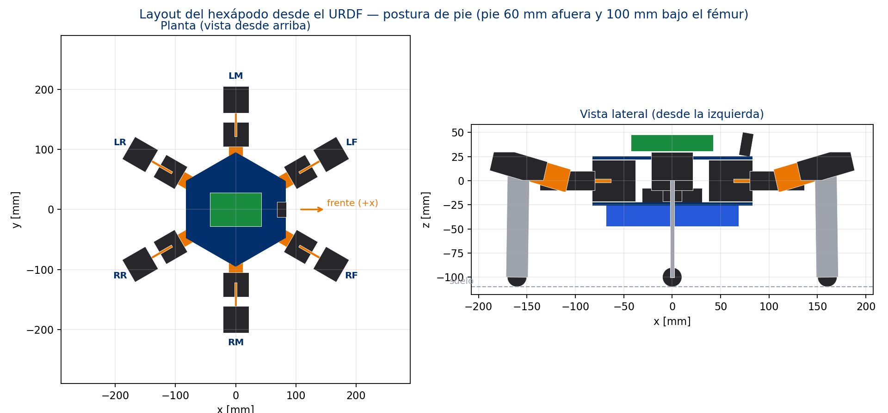

# Hexápodo simulado — Documentación por etapa

Registro de lo que se hizo en cada etapa, por qué y cómo se comprueba. Sirve
para estudiar y para armar la presentación. Las etapas son registro: el
trabajo es continuo. El plan completo está en `docs/plan/plan_ataque.pdf`.

Convención de origen de los datos, igual que en `hexapod_params.xacro`:
**[medido]** por el usuario · **[hoja]** hoja de datos · **[hipótesis]**
estimación propia · **[provisorio]** cota de partida que E8 reemplaza.

---

## E0 — Workspace y parámetros

**Qué se hizo**

- Workspace ROS 2 Jazzy con tres paquetes:

  | Paquete | Tipo | Contenido |
  |---|---|---|
  | `hexapod_description` | ament_cmake | Modelo (URDF/xacro), RViz y launch de visualización |
  | `hexapod_control` | ament_python | Cinemática, marcha y teleoperación (el "cerebro") |
  | `hexapod_bringup` | ament_python | Gazebo, controladores y launch general (desde E3) |

- `hexapod_params.xacro`: **única fuente de verdad** de medidas, masas y
  límites. El URDF y la cinemática leen de ahí; para cambiar el robot se
  toca solo ese archivo.

**Datos reales usados**

| Componente | Dato | Origen |
|---|---|---|
| Servo MG996R | 55 g (incluye adaptadores coaxiales) | medido |
| Servo MG996R | 40,7 × 19,7 × 42,9 mm; 1,08 N·m a 6 V; 0,14 s/60° | hoja |
| Batería LiPo 3S 5200 mAh | 271 g; 137 × 43 × 22 mm | medido |
| Raspberry Pi 4 | 86 g; 85 × 56 mm | medido / hoja |
| PCA9685 (×2) | 9 g c/u | medido |

**Para la presentación:** un solo archivo de parámetros evita que el modelo
de Gazebo, el de RViz y la cinemática digan cosas distintas.

---

## E1 — Una pata: modelo y cinemática

**Conceptos**

- Marco de la pata: origen en el eje de la coxa, x hacia afuera, z hacia arriba.
- θ1 (coxa) gira en torno a z; θ2 (fémur) y θ3 (tibia) giran en torno a −y,
  para que θ2 > 0 suba el fémur y θ3 < 0 doble la tibia hacia abajo.
- Cinemática directa (FK):
  r = L1 + L2 cos θ2 + L3 cos(θ2+θ3);  x = r cos θ1;  y = r sin θ1;
  z = L2 sin θ2 + L3 sin(θ2+θ3).
- Cinemática inversa (IK), rodilla arriba: θ1 = atan2(y, x); con
  ρ = √(x²+y²) − L1 y D² = ρ² + z², la ley de cosenos da
  cos θ3 = (D² − L2² − L3²)/(2 L2 L3), θ3 = −arccos(·) y
  θ2 = atan2(z, ρ) − atan2(L3 sin θ3, L2 + L3 cos θ3).

**Qué se hizo**

- `urdf/leg.xacro`: macro de una pata (coxa, fémur, tibia, pie esférico),
  con los servos dibujados donde van y el centro de masa ponderado de pieza
  + servo en cada link.
- `urdf/leg_test.urdf.xacro`: una pata sola sobre un soporte.
- `hexapod_control/kinematics.py`: `fk`, `ik` y `leg_geometry_from_urdf`
  (lee L1, L2, L3 y los límites desde el propio URDF). Si el punto no se
  alcanza o sale de los límites, lanza `UnreachableError`.

**Evidencia**

| Entregable | Comprobación | Resultado |
|---|---|---|
| D3 IK correcta | `test_kinematics.py`: FK(IK(p)) = p en 5000 puntos | error < 0,1 mm ✅ |
| D4 URDF = cinemática | `test_kinematics_urdf.py`: pie del URDF vs `fk()` en 500 poses | error < 0,1 mm ✅ |
| D4 en ejecución | `tf2_echo base_link test_foot_link` con todo en 0 | (0,245; 0; 0) = L1+L2+L3 ✅ |

**Detalle para estudiar:** un pie *detrás* del eje de la coxa (bajo el
cuerpo) también se alcanza girando la coxa 180°. La IK siempre da la
solución con el pie hacia afuera, que es la que usa la marcha.

---

## E2 — Hexápodo completo en RViz

**Diseño**

- Cuerpo: hexágono **regular y horizontal**, dos placas separadas 45 mm
  (lo justo para el alto del servo, 42,9 mm). Radio al eje de la coxa
  R = 100 mm [provisorio]; las placas sobresalen 15 mm más para sujetar el
  servo y su adaptador.
- Patas en los 6 vértices; el frente (+x) mira a un **lado plano**:

  | Pata | Ángulo | | Pata | Ángulo |
  |---|---|---|---|---|
  | lf | +30° | | rf | −30° |
  | lm | +90° | | rm | −90° |
  | lr | +150° | | rr | −150° |

- URDF no tiene prisma hexagonal: se arma con **3 rectángulos** de
  2a × s (a = apotema, s = lado) girados 0°, 60° y 120°. Sus esquinas son
  los vértices, así que la unión es el hexágono exacto.
- `base_link` es la raíz y **no tiene masa**: KDL (que usa
  robot_state_publisher) no la admite en la raíz. La masa de placas y
  cables va en `body_link`, unido por junta fija. Gazebo junta los links
  fijos y los simula como un solo cuerpo.

**Layout de componentes** (`components.xacro`, `sensors.xacro`)

| Componente | Dónde | Por qué |
|---|---|---|
| Batería | Bajo la placa inferior, largo hacia adelante | Es la masa mayor después de los servos: abajo baja el centro de masa. No cabe entre las placas (necesita 72 mm de radio; los servos dejan 69 mm) |
| Raspberry Pi 4 | Sobre la placa superior, al centro | Acceso a puertos y a la cámara; en el robot real es el controlador |
| PCA9685 ×2 | Entre placas, al centro (0x40 izquierda, 0x41 derecha) | Cerca de los servos, protegidas |
| IMU BNO085 | Centro del cuerpo, bajo la placa superior | En el centro mide la orientación sin aceleraciones extra por giro |
| Cámara Pi Module 3 | Lado frontal, inclinada ~10° al suelo | Ve el terreno que viene |
| Servos de coxa ×6 | Entre placas, eje en cada vértice, cuerpo hacia adentro | El eje de la coxa es el vértice |

`camera_optical_link` sigue la convención óptica de ROS (z adelante, x a la
derecha, y abajo), que es la que esperan las imágenes.

**Evidencia** (`test_hexapod_model.py` + prueba en ejecución)

| Entregable | Comprobación | Resultado |
|---|---|---|
| D5 modelo completo | `check_urdf`: 39 links, raíz `base_link` | ✅ |
| D6 18 articulaciones | 18 revolutas con nombres `{pata}_{coxa,femur,tibia}_joint`; 18 nombres en `/joint_states` | ✅ |
| D6 patas en vértices | Cada coxa a R = 100 mm en su ángulo y apuntando hacia afuera; pie de cada pata = `fk()` | ✅ (p. ej. pie lf en (0,299; 0,173) = 0,345 m a 30°) |
| D7 masa | Suma de masas del URDF = **1,876 kg** (plan: 1,87 ± 0,05) | ✅ |
| Equilibrio | Centro de masa a < 5 mm del eje vertical | ✅ |

Figura de layout generada desde el URDF (`analysis/plot_layout.py`):



Con la postura de pie de partida (pie 70 mm afuera y 90 mm bajo el fémur)
la batería queda a **52 mm del suelo**.

**Primeras observaciones para el estudio de dimensiones (E8)**

- Con L1 = 45 mm, el servo del fémur empieza a ~25 mm del eje de la coxa y
  la placa sobresale 15 mm: quedan ~10 mm de holgura con la pata recta.
  L1 no debería bajar de ~40 mm sin achicar el margen de placa.
- En la postura de pie (θ2 ≈ 22°, θ3 ≈ −114°) el eje de la rodilla queda
  30 mm sobre el centro del cuerpo y su servo llega a ~50 mm, a la altura de
  la Raspberry: revisar choques con el cuerpo al girar la coxa.

**Cómo verlo**

```bash
ros2 launch hexapod_description display.launch.py                  # hexápodo, 18 sliders
ros2 launch hexapod_description display.launch.py model:=leg_test   # una pata
python3 analysis/plot_layout.py                                     # regenera la figura
```

---

## E3 — De pie en Gazebo

**Conceptos**

- **Base flotante:** nada une el cuerpo al mundo. El robot se sostiene solo
  si los pies tocan el suelo, la fricción impide que resbalen y los servos
  aguantan el peso.
- **gz_ros2_control:** conecta ros2_control con el motor de física. Por
  cada articulación ofrece una interfaz de **comando** de posición y de
  **estado** de posición, velocidad y torque (`effort`). En modo posición
  manda a la junta una velocidad proporcional al error. El motor de física
  la limita con el torque (1,08 N·m) y la velocidad (7,48 rad/s) del URDF:
  un servo simulado no puede hacer más fuerza que el real.
- **Contacto:** pie esférico con μ = 1 y un contacto algo blando (kp, kd,
  minDepth en `gazebo.xacro`) para que no rebote ni tiemble.
- **Odometría de referencia:** el plugin `OdometryPublisher` publica la pose
  real del cuerpo (`/hexapod/odom` y la TF `odom → base_link`). No es un
  sensor del robot real; sirve para medir en la simulación.

**Qué se hizo**

| Archivo | Rol |
|---|---|
| `hexapod_description/urdf/ros2_control.xacro` | 18 articulaciones con comando de posición y estados posición/velocidad/torque |
| `hexapod_description/urdf/gazebo.xacro` | Contacto de los pies y odometría de referencia |
| `hexapod_bringup/config/controllers.yaml` | `joint_state_broadcaster` + `legs_controller` (JointGroupPositionController, 18 juntas) |
| `hexapod_bringup/config/gait.yaml` | Posturas recogida y de pie, tiempos |
| `hexapod_bringup/config/gz_bridge.yaml` | `/clock`, `/hexapod/odom`, `/tf` |
| `hexapod_bringup/worlds/hexapod_world.sdf` | Suelo plano y tres objetos al frente para la cámara |
| `hexapod_bringup/launch/gazebo.launch.py` | Gazebo → robot → broadcaster → controlador → `gait_node`, en ese orden |
| `hexapod_control/robot_model.py` | Lee del URDF el montaje y la geometría de cada pata; cambia entre marco del cuerpo y de la pata |
| `hexapod_control/gait_node.py` | Postura suave (en E4 suma la marcha) |

**Postura suave en 3 fases** (`gait_node`)

1. **Recoger** (1 s): desde los ángulos medidos hasta las patas recogidas,
   articulación por articulación. El cuerpo sigue apoyado en la batería.
2. **Parar** (2,5 s): los pies bajan en línea recta, con IK en cada paso,
   hasta la postura de pie. El cuerpo sube de 47,5 a 100 mm.
3. **De pie:** mantiene la postura.

Las interpolaciones usan s(t) = (1 − cos πt)/2, que parte y llega con
velocidad cero.

**Problemas encontrados y cómo se resolvieron**

| Problema | Causa | Solución |
|---|---|---|
| `gait_node` se detuvo: tibia −2,585 rad fuera de [−2,5; 0,6] | La postura recogida (pie a 60 mm del fémur) exigía doblar la tibia 148° | Pie recogido a 80 mm: tibia −2,35 rad (135°). La IK avisó con un error en vez de mandar un ángulo imposible |
| El robot no se levantaba: tibias trabadas a −0,99 rad | El nodo leyó el tiempo antes de que llegara `/clock` (t = 0), se saltó las fases y pidió la postura de pie desde las patas rectas. Los pies apoyaron lejos (22 cm del eje) y la fricción los trabó | Esperar a que el tiempo simulado sea > 0. Con la fase de recoger, los pies apoyan cerca y el cuerpo sube sin trabarse |

Lección para el robot real: **nunca pasar directo de patas estiradas a la
postura de pie.** Primero recoger, después bajar los pies.

**Evidencia**

| Entregable | Comprobación | Resultado |
|---|---|---|
| D8 de pie 60 s | `scripts/medir_postura.py --segundos 60` (odometría de referencia, desde 5 s después de levantarse) | Altura 100,00 mm, variación ±0,00 mm, inclinación 0°, deriva 0 mm ✅ |
| D9 controladores | `ros2 control list_controllers` | `joint_state_broadcaster` y `legs_controller` *active* ✅ |
| Consistencia | `test_config_consistency.py`: orden de las 18 juntas igual en `controllers.yaml` y `gait_node`; posturas de `gait.yaml` dentro de los límites | ✅ |

**Primer dato de torque para E8** (interfaz `effort`, peor articulación):

| Articulación | De pie (6 patas apoyadas) | Pico durante la subida | % del torque de bloqueo (1,08 N·m) |
|---|---|---|---|
| Coxa | ≈ 0 | 0,19 N·m | 17 % |
| Fémur | 0,16 N·m | 0,58 N·m | 54 % |
| Tibia | 0,01 N·m | 0,64 N·m | 59 % |

De pie, la tibia casi no trabaja porque el pie queda bajo la rodilla. El
pico es al levantar el cuerpo. La marcha (E4) apoya en 3 patas y no en 6,
así que hay que medir de nuevo ahí.

**Cómo verlo**

```bash
ros2 launch hexapod_bringup gazebo.launch.py                 # Gazebo + RViz
python3 scripts/medir_postura.py --segundos 60               # en otra terminal
ros2 control list_controllers
```
