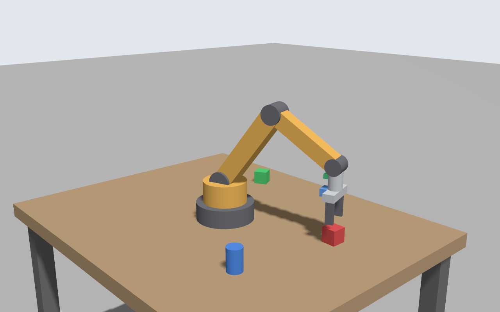
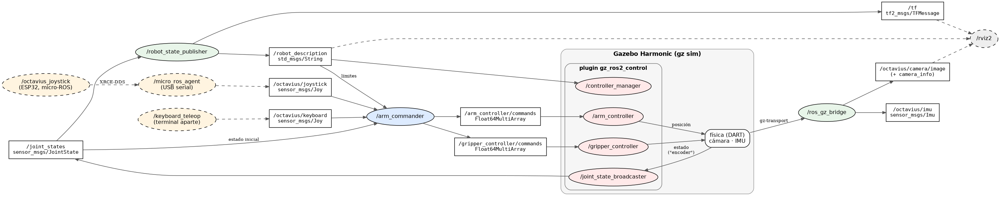
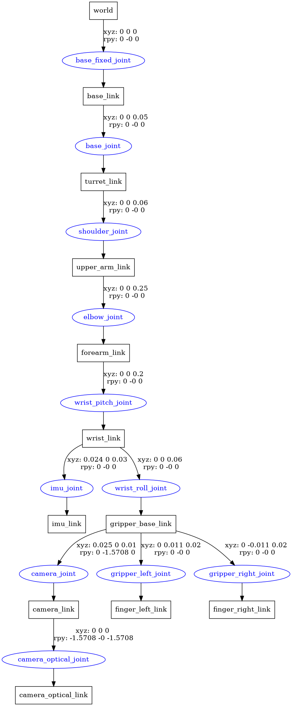
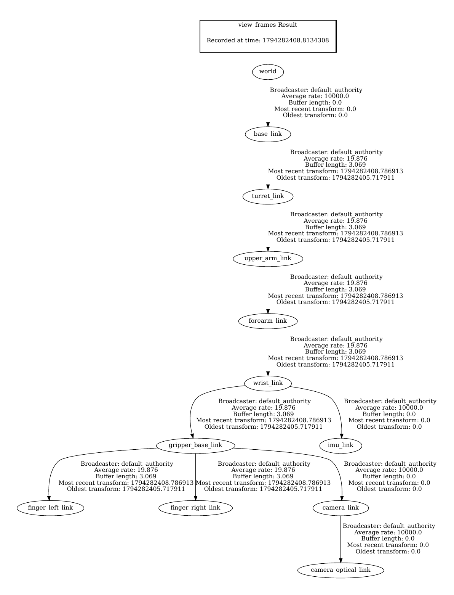
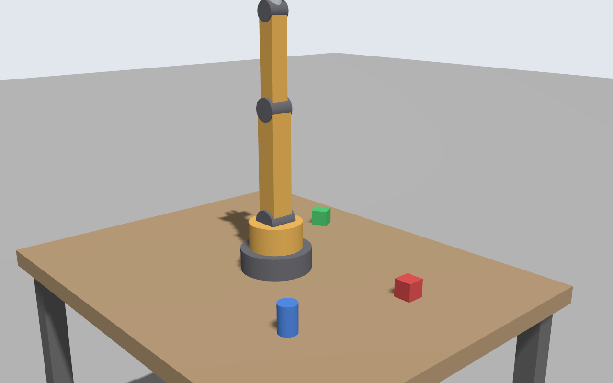
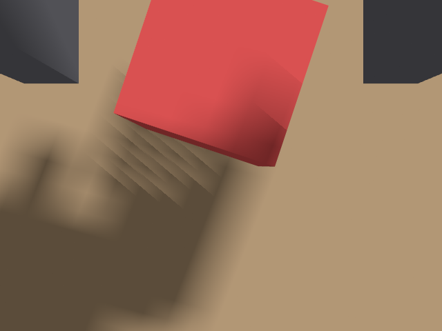
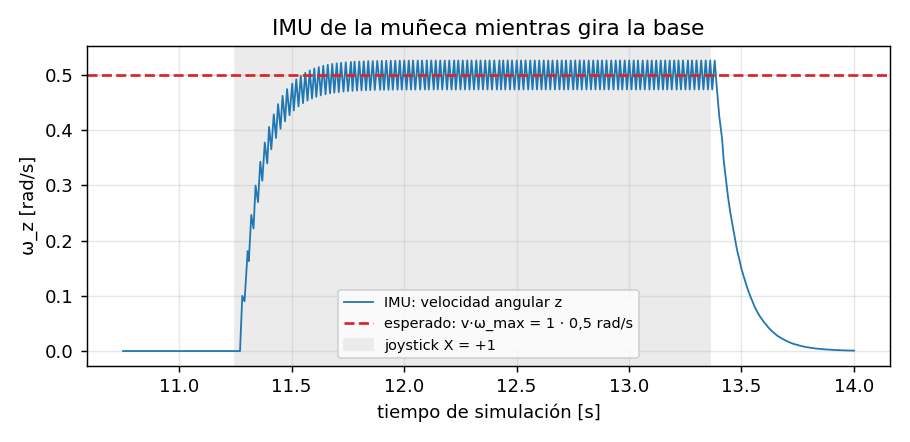
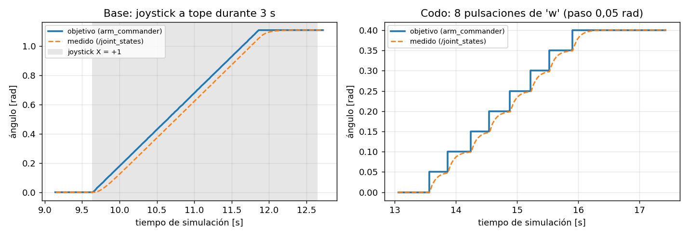

<!-- Membrete -->
|  | **Universidad de Santiago de Chile**<br>Open Robotics — 2° semestre 2026 |
|:---:|:---|

# Octavius: brazo manipulador de 6 articulaciones simulado con ROS 2, Gazebo y micro-ROS

**Documentación técnica y tutorial paso a paso**

| | |
|---|---|
| **Estudiante** | Cesar Olivares Lavalovich |
| **Profesor** | Jose Pascal |
| **Asignatura** | Open Robotics |
| **Fecha** | 10 de noviembre de 2026 |
| **Versión del software** | ROS 2 Jazzy Jalisco · Gazebo Harmonic · Ubuntu 24.04 LTS |
| **Repositorio** | carpeta `Evaluacion_1/` (entrega: `cesar_olivares_2026_2.zip`) |

---

## Índice

1. [Introducción](#1-introducción)
2. [Requisitos del proyecto y trazabilidad](#2-requisitos-del-proyecto-y-trazabilidad)
3. [Entorno y herramientas](#3-entorno-y-herramientas)
4. [Arquitectura del sistema](#4-arquitectura-del-sistema)
5. [Tutorial paso a paso](#5-tutorial-paso-a-paso)
   - 5.1 [Workspace y paquetes](#51-workspace-y-paquetes)
   - 5.2 [Modelo del robot en URDF/XACRO](#52-modelo-del-robot-en-urdfxacro)
   - 5.3 [Visualización en RViz y joint_state_publisher](#53-visualización-en-rviz-y-joint_state_publisher)
   - 5.4 [Simulación en Gazebo](#54-simulación-en-gazebo)
   - 5.5 [Sensores: cámara e IMU](#55-sensores-cámara-e-imu)
   - 5.6 [ros2_control: interfaces y controladores](#56-ros2_control-interfaces-y-controladores)
   - 5.7 [Nodos propios: arm_commander y keyboard_teleop](#57-nodos-propios-arm_commander-y-keyboard_teleop)
   - 5.8 [micro-ROS: joystick con ESP32](#58-micro-ros-joystick-con-esp32)
   - 5.9 [Launch integrado](#59-launch-integrado)
6. [Instalación, ejecución y uso](#6-instalación-ejecución-y-uso)
7. [Verificación y resultados](#7-verificación-y-resultados)
8. [Problemas encontrados y decisiones de ingeniería](#8-problemas-encontrados-y-decisiones-de-ingeniería)
9. [Solución de problemas frecuentes](#9-solución-de-problemas-frecuentes)
10. [Conclusiones y trabajo futuro](#10-conclusiones-y-trabajo-futuro)
11. [Referencias](#11-referencias)
- [Anexo A. Estructura de archivos](#anexo-a-estructura-de-archivos)
- [Anexo B. Índice de figuras, tablas y ecuaciones](#anexo-b-índice-de-figuras-tablas-y-ecuaciones)

---

## 1. Introducción

### 1.1 Contexto

Un robot real se desarrolla y prueba primero en simulación: así se valida el modelo, el control y la comunicación sin arriesgar hardware. ROS 2 (*Robot Operating System 2*) es el estándar abierto para esto. Organiza el software en **nodos** que intercambian mensajes por **tópicos**, y se integra con el simulador físico **Gazebo** y con microcontroladores mediante **micro-ROS** [1], [7].

Este proyecto desarrolla **Octavius**, un brazo manipulador de 6 articulaciones: base giratoria, hombro, codo, muñeca (inclinación y giro) y garra. El brazo se describe en URDF/XACRO, se visualiza en RViz, se simula en Gazebo con sensores, se controla con `ros2_control` y se teleopera con el teclado y con un joystick físico conectado a una ESP32 por micro-ROS.

### 1.2 Objetivos

**Objetivo general.** Desarrollar una aplicación ROS 2 que modele, simule y controle un brazo manipulador articulado, integrando visualización, sensores, `ros2_control` y micro-ROS, siguiendo las convenciones de la documentación oficial de ROS 2.

**Objetivos específicos.**

1. Modelar un brazo de 6 articulaciones en XACRO, con dimensiones, masas, inercias y límites coherentes.
2. Visualizar el modelo y su árbol de transformadas (TF) en RViz, moviendo las articulaciones con `joint_state_publisher`.
3. Simular el brazo en Gazebo Harmonic con dos sensores montados en el brazo: una cámara y una IMU.
4. Controlar las articulaciones con `ros2_control` y teleoperarlas con el teclado.
5. Controlar la base y el hombro con un joystick físico conectado a una ESP32 mediante micro-ROS.
6. Iniciar todo el sistema con un único *launch file*.
7. Entregar un proyecto reproducible, probado y documentado de modo que cualquier persona pueda instalarlo, ejecutarlo y entender cada componente.

### 1.3 Criterio de documentación

Cada componente se explica respondiendo cuatro preguntas:

1. **Qué es**: de qué paquete oficial viene y qué hace.
2. **Por qué se usa**: qué problema resuelve y qué alternativa se descartó.
3. **Qué datos entran y salen**: tópicos, tipos de mensaje, unidades y frecuencias.
4. **Cómo se procesan los datos**: fórmulas y pasos, con ecuaciones numeradas.

Todos los valores numéricos de este documento (frecuencias, ángulos, errores) se **midieron** en la simulación; no son estimaciones. Los registros están en `docs/evidencia/` y los scripts que los generan en `scripts/`.

---

## 2. Requisitos del proyecto y trazabilidad

La Tabla 1 relaciona cada requisito del enunciado con lo implementado y con la forma de verificarlo.

**Tabla 1.** Trazabilidad de requisitos.

| # | Requisito | Cómo se cumple | Verificación | Estado |
|---|---|---|---|---|
| R1 | Paquete con sus directorios | Workspace colcon con `octavius_description` y `octavius_bringup` (§5.1) | `colcon build` sin errores | ✅ |
| R2 | Robot articulado en URDF/XACRO | XACRO modular de 6 articulaciones (§5.2) | `check_urdf`; Figura 3 | ✅ |
| R3 | Cargar el modelo en RViz | `display.launch.py` (§5.3) | Captura de RViz | ✅ |
| R4 | `joint_state_publisher` para mover articulaciones | `joint_state_publisher_gui` con un *slider* por junta | Mover *sliders* | ✅ |
| R5 | Percepción en RViz: RobotModel y TF | Configuración `.rviz` con RobotModel, TF e Image | Figura 4 | ✅ |
| R6 | Cargar el modelo en Gazebo | `gazebo.launch.py` con `ros_gz_sim create` (§5.4) | Figuras 1 y 5 | ✅ |
| R7 | ≥ 2 plugins de sensores | Cámara RGB en la garra + IMU en la muñeca (§5.5) | Figuras 6 y 7; Tabla 24 | ✅ |
| R8 | `ros2_control` con control por teclado | `gz_ros2_control` + `keyboard_teleop` (§5.6, §5.7) | Figura 8; Tabla 23 | ✅ |
| R9 | Control de articulaciones con micro-ROS | ESP32 + joystick → base y hombro (§5.8) | Firmware compila sin advertencias; agente probado | 🟡 falta prueba con hardware |
| R10 | Iniciar con un *launch file* | `bringup.launch.py` (§5.9) | Un solo comando | ✅ |
| R11 | Estructura de carpetas recomendada | Estructura estándar de ROS 2 (Anexo A) | Revisión | ✅ |
| R12–R14 | Presentación, tutorial y entrega en `.zip` | Este documento; `scripts/make_release.sh` | Prueba en limpio (§7.3) | ✅ (presentación aparte) |

---

## 3. Entorno y herramientas

**Tabla 2.** Software utilizado (versiones verificadas en el equipo de desarrollo).

| Componente | Versión | Función en el proyecto |
|---|---|---|
| Ubuntu | 24.04 LTS | Sistema operativo |
| ROS 2 | Jazzy Jalisco | Middleware: nodos, tópicos, parámetros, *launch* |
| Gazebo | Harmonic (gz-sim 8) | Simulador físico y de sensores |
| `ros_gz` | 1.0.24 | Puente Gazebo ↔ ROS 2 y aparición del robot |
| `ros2_control` / `ros2_controllers` | 4.48 / 4.42 | Arquitectura de control y controladores |
| `gz_ros2_control` | 1.2.20 | Hardware simulado de `ros2_control` dentro de Gazebo |
| `micro_ros_arduino` | 2.0.8-jazzy | Cliente micro-ROS para la ESP32 |
| `micro_ros_agent` | jazzy | Agente micro-ROS en el PC |
| Arduino IDE / núcleo ESP32 | 2.3 / 2.0.2 | Compilación y carga del firmware |
| Python | 3.12 | Nodos propios y pruebas |

**Hardware.** Un PC con Ubuntu 24.04. Para la Fase de micro-ROS, una ESP32 DevKit y un joystick analógico de 2 ejes (tipo KY-023).

---

## 4. Arquitectura del sistema

### 4.1 Vista general



**Figura 1.** Octavius en Gazebo Harmonic, con la garra abierta sobre el cubo rojo. Imagen renderizada por el propio Gazebo desde una cámara de vista general.

El proyecto se divide en dos paquetes ROS 2, más el firmware de la ESP32:

**Tabla 3.** Paquetes del proyecto.

| Paquete | Tipo | Contenido |
|---|---|---|
| `octavius_description` | `ament_cmake` | Solo el modelo: URDF/XACRO, configuración de RViz y `display.launch.py` |
| `octavius_bringup` | `ament_python` | Simulación, control y nodos propios: mundo, controladores, puente, *launch files*, `arm_commander` y `keyboard_teleop` |
| `firmware/octavius_joystick` | Sketch Arduino | Lectura del joystick y publicación por micro-ROS |

Separar la **descripción** del **bringup** es la convención de los tutoriales oficiales y de `ros2_control_demos`: el modelo queda reutilizable (por ejemplo, para un robot real) sin arrastrar la configuración de simulación.

### 4.2 Flujo de datos



**Figura 2.** Nodos (elipses) y tópicos (rectángulos) de Octavius. Las conexiones en línea continua se registraron con la simulación en marcha. En línea punteada, los nodos que no corrían durante esa captura: el teclado (se abre en una terminal aparte), la ESP32 (hardware) y RViz (la captura se hizo sin interfaz gráfica).

El recorrido de un comando es:

1. **Entrada.** El teclado (`keyboard_teleop`) y el joystick (ESP32 vía `micro_ros_agent`) publican mensajes `sensor_msgs/Joy`.
2. **Integración.** `arm_commander` combina ambas entradas en un único vector de ángulos objetivo, respetando los límites del robot.
3. **Control.** `arm_controller` y `gripper_controller` aplican esos ángulos a las interfaces de comando de `ros2_control`.
4. **Física.** Dentro de Gazebo, `gz_ros2_control` mueve las juntas y mide su posición.
5. **Retroalimentación.** `joint_state_broadcaster` publica la posición medida en `/joint_states`; `robot_state_publisher` la convierte en transformadas (`/tf`) para RViz.
6. **Sensores.** La cámara y la IMU se simulan en Gazebo y llegan a ROS 2 por `ros_gz_bridge`.

---

## 5. Tutorial paso a paso

### 5.1 Workspace y paquetes

**Qué es.** Un *workspace* de colcon es una carpeta con una subcarpeta `src/` que contiene paquetes ROS 2. `colcon build` compila todos los paquetes y deja el resultado en `install/` [1].

**Creación de los paquetes**, con la herramienta oficial `ros2 pkg create`:

```bash
mkdir -p Evaluacion_1/src && cd Evaluacion_1/src
ros2 pkg create --build-type ament_cmake  --license Apache-2.0 octavius_description
ros2 pkg create --build-type ament_python --license Apache-2.0 octavius_bringup
```

**Por qué dos tipos de paquete.**

- `octavius_description` no contiene código: solo instala archivos (`urdf/`, `launch/`, `rviz/`). `ament_cmake` hace eso con una línea `install(DIRECTORY ...)` en `CMakeLists.txt`.
- `octavius_bringup` contiene nodos en Python, por eso es `ament_python`. Sus archivos que no son código (`launch/`, `config/`, `worlds/`) se instalan con `data_files` en `setup.py`, y los nodos se registran como ejecutables en `entry_points`.

**Dependencias.** Cada paquete declara en `package.xml` todo lo que necesita para ejecutarse (`<exec_depend>`) y para sus pruebas (`<test_depend>`). Así `rosdep install --from-paths src --ignore-src -y` instala todo automáticamente en un PC limpio. La prueba en limpio (§7.3) detectó dos dependencias que faltaban declarar (`joint_state_publisher` y `ros2controlcli`); ya están corregidas.

### 5.2 Modelo del robot en URDF/XACRO

#### 5.2.1 Qué es URDF y por qué XACRO

**URDF** (*Unified Robot Description Format*) describe un robot como un árbol de **links** (cuerpos rígidos) unidos por **joints** (articulaciones) [2]. Cada link tiene:

- `visual`: lo que se dibuja.
- `collision`: la forma que usa la física para los choques.
- `inertial`: masa e inercia, que usa la física de Gazebo.

Cada joint define:

- `origin`: dónde está la articulación respecto del link padre.
- `axis`: el eje de giro.
- `limit`: recorrido, velocidad y torque máximos.

**XACRO** es un preprocesador de XML que agrega variables, operaciones y macros a URDF [3]. Se usa porque un URDF plano repetiría las mismas dimensiones y fórmulas en decenas de lugares: con XACRO cada valor se define una sola vez.

El modelo está dividido en archivos con una responsabilidad cada uno:

**Tabla 4.** Archivos del modelo XACRO.

| Archivo | Contenido |
|---|---|
| `octavius.urdf.xacro` | Archivo principal: colores, link `world` y llamadas a las macros |
| `octavius_params.xacro` | **Único lugar** con dimensiones, masas y límites |
| `macros/inertial.xacro` | Fórmulas de inercia (ecuaciones 1 y 2) |
| `arm.xacro` | Base y articulaciones 1 a 4 |
| `gripper.xacro` | Articulación 5 (giro de muñeca) y garra (articulación 6) |
| `sensors.xacro` | Cámara e IMU con sus plugins de Gazebo |
| `ros2_control.xacro` | Interfaces de control para `gz_ros2_control` |

#### 5.2.2 Geometría y masas

La geometría usa primitivas (cilindros y cajas), sin mallas externas: el modelo no depende de archivos adicionales y su inercia se calcula exactamente.

**Tabla 5.** Dimensiones y masas de los links (definidas en `octavius_params.xacro`).

| Link | Forma | Dimensiones [m] | Masa [kg] |
|---|---|---|---|
| `base_link` | Cilindro | r = 0,08; h = 0,05 | 1,00 |
| `turret_link` | Cilindro | r = 0,06; h = 0,06 | 0,50 |
| `upper_arm_link` | Caja | 0,05 × 0,05 × 0,25 | 0,40 |
| `forearm_link` | Caja | 0,04 × 0,04 × 0,20 | 0,30 |
| `wrist_link` | Cilindro | r = 0,018; h = 0,06 | 0,10 |
| `gripper_base_link` | Caja | 0,03 × 0,09 × 0,02 | 0,08 |
| `finger_left_link`, `finger_right_link` | Caja | 0,02 × 0,01 × 0,06 | 0,02 c/u |
| `camera_link` | Caja | 0,02 × 0,03 × 0,02 | 0,01 |
| `imu_link` | Cubo | 0,012 | 0,005 |
| **Total** | | | **2,435** |

**Pose cero.** Con todas las articulaciones en 0, el brazo queda vertical apuntando a +Z. Por eso el hombro, el codo y la inclinación de muñeca giran en torno a Y, y el giro de la garra en torno a Z. En esta pose, la base de la garra queda 0,62 m sobre `base_link`.

#### 5.2.3 Inercias

Gazebo necesita el **tensor de inercia** de cada link para simular su dinámica. Para un sólido homogéneo, respecto de su centro de masa y con los ejes alineados a sus ejes de simetría:

$$\text{Caja } (x, y, z):\quad I_{xx} = \frac{m\,(y^2+z^2)}{12},\quad I_{yy} = \frac{m\,(x^2+z^2)}{12},\quad I_{zz} = \frac{m\,(x^2+y^2)}{12} \tag{1}$$

$$\text{Cilindro } (r, h)\text{, eje Z}:\quad I_{xx} = I_{yy} = \frac{m\,(3r^2+h^2)}{12},\quad I_{zz} = \frac{m\,r^2}{2} \tag{2}$$

Los productos de inercia ($I_{xy}$, $I_{xz}$, $I_{yz}$) son 0 porque los ejes del link coinciden con los de simetría. Las macros `box_inertial` y `cylinder_inertial` aplican estas fórmulas.

**Tabla 6.** Momentos de inercia calculados por las macros (kg·m²).

| Link | $I_{xx}$ | $I_{yy}$ | $I_{zz}$ |
|---|---|---|---|
| `base_link` | 1,808·10⁻³ | 1,808·10⁻³ | 3,200·10⁻³ |
| `turret_link` | 6,000·10⁻⁴ | 6,000·10⁻⁴ | 9,000·10⁻⁴ |
| `upper_arm_link` | 2,167·10⁻³ | 2,167·10⁻³ | 1,667·10⁻⁴ |
| `forearm_link` | 1,040·10⁻³ | 1,040·10⁻³ | 8,000·10⁻⁵ |
| `wrist_link` | 3,810·10⁻⁵ | 3,810·10⁻⁵ | 1,620·10⁻⁵ |
| `gripper_base_link` | 5,667·10⁻⁵ | 8,667·10⁻⁶ | 6,000·10⁻⁵ |
| cada dedo | 6,167·10⁻⁶ | 6,667·10⁻⁶ | 8,333·10⁻⁷ |

*Ejemplo* (`upper_arm_link`, ec. 1): $I_{xx} = 0{,}4\,(0{,}05^2 + 0{,}25^2)/12 = 2{,}167\cdot10^{-3}$ kg·m².

#### 5.2.4 Articulaciones y límites

**Tabla 7.** Articulaciones de Octavius.

| # | Joint | Tipo | Eje | Recorrido | Vel. máx. | Esfuerzo máx. | Control |
|---|---|---|---|---|---|---|---|
| 1 | `base_joint` | revolute | Z | ±π rad (±180°) | 1,5 rad/s | 20 N·m | Joystick X |
| 2 | `shoulder_joint` | revolute | Y | ±π/2 rad (±90°) | 1,5 rad/s | 20 N·m | Joystick Y |
| 3 | `elbow_joint` | revolute | Y | ±0,75π rad (±135°) | 1,5 rad/s | 20 N·m | Teclado `w`/`s` |
| 4 | `wrist_pitch_joint` | revolute | Y | ±π/2 rad (±90°) | 1,5 rad/s | 20 N·m | Teclado `r`/`f` |
| 5 | `wrist_roll_joint` | revolute | Z | ±π rad (±180°) | 1,5 rad/s | 20 N·m | Teclado `q`/`e` |
| 6 | `gripper_left_joint` + `gripper_right_joint` | prismatic ×2 | +Y / −Y | 0 a 0,025 m | 0,05 m/s | 10 N | Teclado `a` |

Todas las juntas revolutas tienen amortiguamiento 0,5 y fricción 0,1, que solo usa Gazebo, para evitar oscilaciones.

**La garra es un solo grado de libertad.** Físicamente son dos juntas prismáticas (un dedo cada una) que **siempre reciben el mismo valor**. Como el eje del dedo derecho apunta a −Y, ambos dedos se mueven en espejo, igual que una garra real cuyos dedos están acoplados por un mismo mecanismo. Por eso el robot tiene 6 grados de libertad: 5 del brazo y 1 de la garra. La sección 8.1 explica por qué no se usó una junta `mimic`.



**Figura 3.** Árbol del URDF generado con `urdf_to_graphviz`. Rectángulos: links; elipses: joints, con la posición (`xyz`) y orientación (`rpy`) de cada una respecto de su padre.

#### 5.2.5 Parámetros de Denavit–Hartenberg

La convención **Denavit–Hartenberg estándar** [11] describe la cinemática del brazo con 4 parámetros por articulación. La transformación del sistema $i-1$ al sistema $i$ es:

$$A_i = R_z(\theta_i)\; T_z(d_i)\; T_x(a_i)\; R_x(\alpha_i) \tag{3}$$

y la pose de la garra respecto de la base es el producto:

$$T_0^5 = A_1\,A_2\,A_3\,A_4\,A_5 \tag{4}$$

**Tabla 8.** Parámetros DH de Octavius ($q_i$ = ángulo de la articulación $i$ en el URDF).

| $i$ | $\theta_i$ | $d_i$ [m] | $a_i$ [m] | $\alpha_i$ |
|---|---|---|---|---|
| 1 | $q_1$ | 0,11 | 0 | −90° |
| 2 | $q_2 - 90°$ | 0 | 0,25 | 0 |
| 3 | $q_3$ | 0 | 0,20 | 0 |
| 4 | $q_4 + 90°$ | 0 | 0 | +90° |
| 5 | $q_5$ | 0,06 | 0 | 0 |

- $d_1 = 0{,}11$ m es la altura del hombro: base (0,05) + torreta (0,06).
- $a_2$ y $a_3$ son las longitudes del brazo y del antebrazo.
- $d_5 = 0{,}06$ m es el largo de la muñeca hasta la base de la garra.
- Los desfases de −90° y +90° aparecen porque en el URDF la pose cero es el brazo vertical, mientras que en DH el eslabón queda a lo largo de $x_i$.

**Validación.** La tabla no se derivó solo a mano: se comprobó numéricamente de dos maneras.

1. Contra la cinemática directa del URDF en 200 configuraciones aleatorias: el error máximo fue de 3·10⁻¹⁶ m (cero numérico), y el sistema DH final coincide exactamente con `gripper_base_link`, sin rotación adicional.
2. Contra la TF real que publica `robot_state_publisher`, en la configuración $q = (0{,}4;\,-0{,}6;\,1{,}1;\,0{,}7;\,0{,}9)$: ambas dan la posición (0,00981; 0,00415; 0,51359) m.

La misma tabla se usó para calcular, por cinemática inversa, la pose de la Figura 1 (garra 0,12 m sobre el cubo, apuntando hacia abajo): $q = (0{,}322;\ 0{,}641;\ 1{,}515;\ 0{,}986;\ 0)$ rad.

### 5.3 Visualización en RViz y joint_state_publisher

**Archivo:** `octavius_description/launch/display.launch.py`.

```bash
ros2 launch octavius_description display.launch.py
```

**Qué hace cada nodo.**

**Tabla 9.** Nodos de `display.launch.py`.

| Nodo | Paquete | Entrada | Salida | Función |
|---|---|---|---|---|
| `robot_state_publisher` | `robot_state_publisher` | parámetro `robot_description` (URDF); `/joint_states` | `/tf`, `/tf_static`, `/robot_description` | Calcula la posición de cada link (cinemática directa) |
| `joint_state_publisher_gui` | `joint_state_publisher_gui` | URDF | `/joint_states` | Un *slider* por articulación móvil |
| `rviz2` | `rviz2` | `/robot_description`, `/tf` | — | Dibuja el robot y sus sistemas de referencia |

**Cómo se procesa el URDF.** El *launch* ejecuta `xacro octavius.urdf.xacro` al iniciar y pasa el resultado (URDF en texto) como parámetro `robot_description`. No hay un `.urdf` generado a mano que pueda quedar desactualizado.

**RViz** (`rviz/display.rviz`) muestra:

- **RobotModel:** el robot dibujado desde `/robot_description`.
- **TF:** los ejes de cada link, con sus nombres.
- El *Fixed Frame* es `world`.

Mover un *slider* publica un nuevo `/joint_states`, `robot_state_publisher` recalcula la TF y RViz redibuja el brazo.



**Figura 4.** Árbol de transformadas generado con `ros2 run tf2_tools view_frames`. Las juntas móviles se publican en `/tf` (≈ 20 Hz en esta captura). Las fijas (`base_link`, cámara, IMU) aparecen con "*Average rate: 10000*": se publican una sola vez en `/tf_static`, porque nunca cambian.

**Frame óptico de la cámara.** Hay dos frames para la cámara porque las convenciones difieren (REP-103 [9]):

- `camera_link` sigue la convención de los cuerpos: X adelante, Z arriba.
- `camera_optical_link` sigue la de las imágenes: Z adelante, X a la derecha, Y abajo. Los mensajes de imagen se publican con este frame.

### 5.4 Simulación en Gazebo

#### 5.4.1 El mundo

**Archivo:** `octavius_bringup/worlds/workcell.sdf`. Es una mesa de 1,0 × 0,8 m a 0,75 m de altura, con un cubo rojo, un cilindro azul y un cubo verde al alcance del brazo. Todo está hecho con primitivas: el mundo **no descarga modelos de internet**, así que funciona sin conexión.

Un mundo de Gazebo no simula nada si no carga sus **sistemas** (plugins) [5]:

**Tabla 10.** Sistemas de Gazebo cargados en `workcell.sdf`.

| Sistema | Función |
|---|---|
| `gz-sim-physics-system` | Integra la dinámica con el motor **DART** (paso de 1 ms) |
| `gz-sim-user-commands-system` | Permite crear modelos en ejecución (lo usa `ros_gz_sim create`) |
| `gz-sim-scene-broadcaster-system` | Envía la escena a la interfaz gráfica |
| `gz-sim-sensors-system` | Renderiza los sensores de imagen (la cámara), con `ogre2` |
| `gz-sim-imu-system` | Calcula las lecturas de las IMU |



**Figura 5.** Celda de trabajo con Octavius en la pose cero (brazo vertical).

#### 5.4.2 Cómo aparece el robot

**Archivo:** `octavius_bringup/launch/gazebo.launch.py`. La secuencia es:

1. `ros_gz_sim` abre Gazebo con el mundo.
2. `robot_state_publisher` publica el URDF en `/robot_description`.
3. `ros_gz_sim create` lee ese tópico y crea el robot en z = 0,75 m, sobre la mesa. Una junta fija entre `world` y `base_link` lo deja atornillado a la mesa.
4. Al cargarse el robot, el plugin `gz_ros2_control` levanta un `controller_manager` dentro de Gazebo.
5. Los controladores se activan **en orden** (§5.6.4).
6. `ros_gz_bridge` conecta los sensores y el reloj con ROS 2 (§5.5.3).

**Tiempo simulado.** Todos los nodos usan `use_sim_time:=true`: su reloj es `/clock`, que publica Gazebo, y no el reloj del PC. Así las marcas de tiempo de sensores, TF y comandos coinciden aunque la simulación corra más lenta que el tiempo real (en el PC de desarrollo, con gráficos integrados, el factor de tiempo real medido estuvo entre 0,43 y 0,84 según la carga).

### 5.5 Sensores: cámara e IMU

Ambos sensores van **montados en el brazo** y son plugins nativos de Gazebo. Cada uno tiene dos partes en `sensors.xacro`:

1. Un `<link>` con un `<joint>` fijo, que lo ubica en el robot y lo hace aparecer en la TF.
2. Un bloque `<gazebo reference="...">` con el `<sensor>`, que Gazebo simula y publica en un tópico propio.

#### 5.5.1 Sensor 1: cámara RGB en la garra

**Tabla 11.** Sensor 1: cámara de la garra.

| Pregunta | Respuesta |
|---|---|
| **Qué es** | Sensor `camera` de Gazebo, renderizado por `gz-sim-sensors-system` |
| **Por qué** | Es un sensor *eye-in-hand*: ve lo que tiene la garra delante, que es la información útil para tomar objetos |
| **Datos** | `/octavius/camera/image` (`sensor_msgs/Image`, 640 × 480 RGB, 15 Hz en tiempo simulado) y `/octavius/camera/camera_info` (`sensor_msgs/CameraInfo`: distancia focal y centro óptico) |
| **Procesamiento** | Campo de visión horizontal de 60°, recorte de 0,02 a 10 m y ruido gaussiano σ = 0,007 por píxel, para que la imagen no sea "perfecta". Se muestra en el panel *Image* de RViz |

La cámara va en la cara +X de la base de la garra. Una cámara de Gazebo mira hacia el +X de su link, así que se gira −90° en Y para que mire hacia donde apuntan los dedos.



**Figura 6.** Imagen publicada en `/octavius/camera/image` con la garra sobre el cubo rojo. Los bordes oscuros a izquierda y derecha son los dos dedos abiertos: la imagen confirma la orientación de la cámara y la pose calculada con la tabla DH.

#### 5.5.2 Sensor 2: IMU en la muñeca

**Tabla 12.** Sensor 2: IMU de la muñeca.

| Pregunta | Respuesta |
|---|---|
| **Qué es** | Sensor `imu` de Gazebo, calculado por `gz-sim-imu-system` |
| **Por qué** | Mide el movimiento real de la muñeca, de forma independiente de los comandos: sirve para comprobar que el brazo hace lo que se le ordena |
| **Datos** | `/octavius/imu` (`sensor_msgs/Imu`, 100 Hz en tiempo simulado): orientación (cuaternión), velocidad angular [rad/s] y aceleración lineal [m/s²], en el frame `imu_link` |
| **Procesamiento** | Se valida comparando su velocidad angular con la velocidad comandada a la base (Figura 7) |

**Validación.** Con el brazo vertical, el eje Z de la IMU coincide con el eje de la base. Si el joystick ordena girar la base a $\omega_{max} = 0{,}5$ rad/s, la IMU debería medir $\omega_z \approx 0{,}5$ rad/s. En la medición, el promedio en régimen fue **0,4984 rad/s** (171 muestras), un error de 0,3 %. En reposo, la aceleración medida es 9,81 m/s² en Z: la gravedad.



**Figura 7.** Velocidad angular z medida por la IMU mientras el joystick (simulado) gira la base al máximo. La oscilación de ±0,026 rad/s no es ruido del sensor (no se configuró ruido en la IMU): `arm_commander` actualiza el objetivo a 50 Hz y el controlador corre a 100 Hz, así que la junta recibe la velocidad "a escalones". El promedio coincide con el valor esperado.

#### 5.5.3 Puente Gazebo ↔ ROS 2

**Qué es.** Gazebo y ROS 2 usan sistemas de mensajería distintos (gz-transport y DDS). `ros_gz_bridge` traduce entre ambos [6]. Se configura en `config/gz_bridge.yaml`; cada entrada indica tópico, tipo de mensaje en cada lado y dirección.

**Tabla 13.** Tópicos traducidos por `ros_gz_bridge` (todos `GZ_TO_ROS`).

| Tópico | Tipo ROS 2 | Tipo Gazebo | Uso |
|---|---|---|---|
| `/clock` | `rosgraph_msgs/msg/Clock` | `gz.msgs.Clock` | Tiempo simulado |
| `/octavius/camera/image` | `sensor_msgs/msg/Image` | `gz.msgs.Image` | Imagen de la cámara |
| `/octavius/camera/camera_info` | `sensor_msgs/msg/CameraInfo` | `gz.msgs.CameraInfo` | Parámetros intrínsecos |
| `/octavius/imu` | `sensor_msgs/msg/Imu` | `gz.msgs.IMU` | IMU |

### 5.6 ros2_control: interfaces y controladores

#### 5.6.1 Qué es ros2_control

`ros2_control` separa el **hardware** de los **controladores** [4]. El hardware expone *interfaces* (valores que se pueden leer o escribir). Los controladores, que son plugins genéricos, leen y escriben esas interfaces. Un `controller_manager` ejecuta el ciclo leer → actualizar controladores → escribir a una frecuencia fija (aquí, **100 Hz**).

En simulación, el hardware es el plugin **`gz_ros2_control/GazeboSimSystem`** [8]: en vez de hablar con motores, lee y escribe las juntas de Gazebo. El mismo controlador funcionaría con un robot real cambiando solo ese plugin.

#### 5.6.2 Interfaces: el "encoder" de la simulación

**Tabla 14.** Interfaces declaradas por cada articulación en `ros2_control.xacro`.

| Interfaz | Sentido | Qué representa | Equivalente en un robot real |
|---|---|---|---|
| `command_interface: position` | Se escribe | Ángulo (o apertura) objetivo | Señal de posición a un servo |
| `state_interface: position` | Se lee | Ángulo medido | Lectura de un **encoder** |
| `state_interface: velocity` | Se lee | Velocidad medida | Derivada de la lectura del encoder |

En Gazebo no hay que agregar un encoder: el plugin lee el ángulo de cada junta desde el motor de física en cada ciclo. Funciona como un **encoder ideal**, con resolución infinita y sin ruido.

#### 5.6.3 El lazo de posición y por qué no hay un PID propio

Con interfaz de **posición**, el lazo cerrado lo resuelve el **hardware**, no el controlador. En un servo real lo cierra su electrónica interna. En Gazebo lo cierra `GazeboSimSystem`, que convierte el error de posición en una velocidad para la junta [8]:

$$\dot q_{cmd} = -K_p\, f\,(q - q_{ref}) \tag{5}$$

donde $K_p = 0{,}1$ es `position_proportional_gain` (valor por defecto) y $f = 100$ Hz la frecuencia del `controller_manager`. Si la junta sigue esa velocidad, la posición evoluciona como un sistema de primer orden:

$$\dot q = -K_p f\,(q - q_{ref}) \;\Rightarrow\; \tau = \frac{1}{K_p\, f} = \frac{1}{0{,}1 \cdot 100} = 0{,}1 \text{ s} \tag{6}$$

Si el objetivo avanza como una rampa de velocidad $\omega$, la junta la sigue con un retraso constante:

$$e_{ss} = \frac{\omega}{K_p\, f} = \frac{0{,}5}{10} = 0{,}05 \text{ rad} \tag{7}$$

Ambas predicciones se ven en la Figura 8. A la izquierda, la base sigue la rampa del joystick con un retraso de ≈ 0,05 rad (ec. 7). A la derecha, cada paso del codo se completa en ≈ 0,3 s, es decir, unas 3τ (ec. 6).

**Por qué no un PID propio.** Un `pid_controller` sobre interfaz de esfuerzo se justifica cuando el actuador entrega torque y no tiene control de posición propio. Un brazo de servos sí lo tiene, así que agregar otro PID sería redundante. Es el mismo criterio de los ejemplos oficiales de `ros2_control_demos` para brazos.

#### 5.6.4 Controladores

**Archivo:** `octavius_bringup/config/controllers.yaml`.

**Tabla 15.** Controladores (todos del paquete oficial `ros2_controllers`).

| Controlador | Tipo | Juntas | Entrada | Qué hace |
|---|---|---|---|---|
| `joint_state_broadcaster` | `joint_state_broadcaster/JointStateBroadcaster` | todas | interfaces de estado | Publica `/joint_states` |
| `arm_controller` | `position_controllers/JointGroupPositionController` | 1–5 | `/arm_controller/commands` (`Float64MultiArray`, 5 valores) | Copia cada valor a la interfaz de comando de su junta, en cada ciclo |
| `gripper_controller` | `position_controllers/JointGroupPositionController` | 2 dedos | `/gripper_controller/commands` (2 valores, siempre iguales) | Ídem, para la garra |

**Por qué `JointGroupPositionController` y no `joint_trajectory_controller` (JTC).** JTC recibe una *trayectoria* (lista de puntos con su instante de llegada), interpola entre ellos y verifica tolerancias [4]. Es el estándar cuando se planifican movimientos completos, por ejemplo con MoveIt. Aquí el operador mueve el brazo en tiempo real y `arm_commander` ya genera incrementos pequeños (0,01 rad cada 20 ms con el joystick a tope), así que la interpolación de JTC no aporta nada. `JointGroupPositionController` es el controlador más simple de `ros2_controllers` y se explica en una línea: *lo que se publica es lo que se aplica*.

**Orden de activación.** En `gazebo.launch.py`, el *spawner* de cada controlador se encadena con `OnProcessExit`:

1. Termina `ros_gz_sim create`: el robot ya existe.
2. Se activa `joint_state_broadcaster`.
3. Al terminar ese *spawner*, se activan `arm_controller` y `gripper_controller`.

Así nunca se intenta activar un controlador antes de que exista el robot.

### 5.7 Nodos propios: arm_commander y keyboard_teleop

#### 5.7.1 Por qué hace falta arm_commander

`arm_controller` necesita recibir **siempre los 5 ángulos juntos**. El joystick mueve la base y el hombro, y el teclado mueve el codo y la muñeca. Si cada fuente publicara directo al controlador, una sobrescribiría lo que mandó la otra. `arm_commander` guarda el vector objetivo completo y lo actualiza con ambas fuentes.

**Tabla 16.** Entradas y salidas de `arm_commander`.

| Tópico | Tipo | Sentido | Uso |
|---|---|---|---|
| `/robot_description` | `std_msgs/String` | entra | Límites de cada junta, leídos del URDF |
| `/joint_states` | `sensor_msgs/JointState` | entra | Posición inicial (una sola vez) |
| `/octavius/joystick` | `sensor_msgs/Joy` | entra | **Modo velocidad**: `axes[0]` → base, `axes[1]` → hombro, en [−1, 1] |
| `/octavius/keyboard` | `sensor_msgs/Joy` | entra | **Modo paso**: `axes[0..2]` ∈ {−1, 0, +1} → codo, muñeca pitch, muñeca roll; `buttons[0]` garra; `buttons[1]` home |
| `/arm_controller/commands` | `std_msgs/Float64MultiArray` | sale | 5 ángulos [rad], a 50 Hz |
| `/gripper_controller/commands` | `std_msgs/Float64MultiArray` | sale | Apertura de cada dedo [m], al cambiar |

Se usa **`sensor_msgs/Joy` para ambas entradas** porque es el mensaje estándar de ROS para mandos (ejes y botones) [10]. Así el joystick y el teclado llegan con el mismo formato.

#### 5.7.2 Cálculos

Todas las fórmulas están en `octavius_bringup/arm_logic.py`, separadas del nodo y sin dependencias de ROS, para poder probarlas con pruebas unitarias (§7.1). El nodo funciona a $\Delta t = 1/50 = 0{,}02$ s.

**Inicialización.** El objetivo inicial es la **posición medida** del brazo (`/joint_states`), no 0. Si partiera en 0, al primer comando el brazo saltaría desde donde esté.

**Límites blandos.** Los límites del URDF son los topes físicos. El nodo trabaja con un margen hacia adentro:

$$[\,q_{min} + m,\; q_{max} - m\,],\qquad m = 0{,}02 \text{ rad} \;(\approx 1{,}1°) \tag{8}$$

Comandar exactamente un tope no es buena práctica: en un robot real, el motor empujaría contra el tope mecánico. Además, en Gazebo con DART, una junta revoluta comandada justo en su límite **queda trabada** (§8.2).

**Zona muerta del joystick.** Un joystick analógico en reposo casi nunca entrega exactamente 0:

$$v = \begin{cases} 0 & |v_{raw}| < 0{,}1 \\ v_{raw} & \text{en otro caso} \end{cases} \tag{9}$$

**Joystick, modo velocidad.** La inclinación $v \in [-1, 1]$ se interpreta como una fracción de la velocidad máxima $\omega_{max} = 0{,}5$ rad/s:

$$q_{obj} \leftarrow \operatorname{sat}\!\left(q_{obj} + v\,\omega_{max}\,\Delta t\right) \tag{10}$$

donde $\operatorname{sat}$ satura dentro de los límites blandos (ec. 8). *Ejemplo:* con el joystick a tope, la base avanza 0,5 · 0,02 = 0,01 rad por ciclo, es decir, 28,6°/s.

**Teclado, modo paso.** Cada pulsación mueve la articulación un paso fijo $p = 0{,}05$ rad (≈ 2,9°), con $d = \pm 1$ según la tecla:

$$q_{obj} \leftarrow \operatorname{sat}\!\left(q_{obj} + d\, p\right) \tag{11}$$

**Retorno a home.** Con la tecla `h`, cada articulación se acerca a 0 a velocidad acotada, sin saltos:

$$q_{obj} \leftarrow q_{obj} - \operatorname{sign}(q_{obj})\,\min\!\left(|q_{obj}|,\; \omega_{home}\,\Delta t\right),\qquad \omega_{home} = 0{,}5 \text{ rad/s} \tag{12}$$

**Watchdog del joystick.** Si no llegan mensajes del joystick en 0,5 s (cable desconectado o ESP32 reiniciada), el nodo deja de mover la base y el hombro en vez de seguir aplicando la última inclinación recibida.

**Garra.** La tecla `a` alterna entre abierta (0,02 m por dedo) y cerrada (0 m). Se publica el mismo valor para ambos dedos.

**Tabla 17.** Parámetros de `config/teleop.yaml`.

| Parámetro | Valor | Unidad | Significado |
|---|---|---|---|
| `rate_hz` | 50 | Hz | Frecuencia del lazo del nodo |
| `joystick_max_velocity` | 0,5 | rad/s | $\omega_{max}$ en la ec. 10 |
| `joystick_deadzone` | 0,1 | — | Umbral de la ec. 9 |
| `joystick_timeout` | 0,5 | s | Watchdog |
| `joystick_axis_sign` | [1, 1] | — | −1 invierte un eje si el joystick quedó montado al revés |
| `keyboard_step` | 0,05 | rad | $p$ en la ec. 11 |
| `limit_margin` | 0,02 | rad | $m$ en la ec. 8 |
| `home_velocity` | 0,5 | rad/s | $\omega_{home}$ en la ec. 12 |
| `gripper_open` / `gripper_closed` | 0,02 / 0 | m | Apertura de cada dedo |



**Figura 8.** Datos registrados en la simulación. **Izquierda:** el joystick a tope durante 2,111 s simulados lleva la base hasta 1,0599 rad (esperado: 2,111 · 0,5 = 1,0555 rad); la posición medida sigue al objetivo con el retraso de la ec. 7. **Derecha:** 8 pulsaciones de `w` llevan el codo exactamente a 0,400 rad, en escalones de 0,05 rad.

#### 5.7.3 keyboard_teleop

`keyboard_teleop` **solo traduce teclas a mensajes**: no conoce ángulos ni límites. Cada tecla válida produce un `sensor_msgs/Joy` en `/octavius/keyboard`.

**Tabla 18.** Mapa de teclas.

| Tecla | Mensaje | Acción |
|---|---|---|
| `w` / `s` | `axes[0] = +1 / −1` | Codo arriba / abajo |
| `r` / `f` | `axes[1] = +1 / −1` | Muñeca pitch arriba / abajo |
| `e` / `q` | `axes[2] = +1 / −1` | Girar la garra |
| `a` | `buttons[0] = 1` | Abrir / cerrar garra |
| `h` | `buttons[1] = 1` | Volver a home |

La terminal se pone en modo *cbreak*: cada tecla llega sin esperar Enter y no se muestra en pantalla. Al salir se restaura la configuración original de la terminal. El nodo necesita leer una terminal, por eso se ejecuta aparte con `ros2 run` y no dentro del *launch*, igual que `teleop_twist_keyboard` en la documentación oficial.

#### 5.7.4 Cierre ordenado del nodo

Con Ctrl+C, la señal `SIGINT` llega **dos veces** a `arm_commander`: desde la terminal y reenviada por el *launch*. Las primeras versiones del nodo a veces quedaban bloqueadas o terminaban con un error. El diseño final es el siguiente:

- Se desactiva el manejador de señales de `rclpy` y se instala uno propio, que **solo levanta una bandera**, sin lanzar excepciones en medio de un *callback*.
- El lazo usa `spin_once` con un *timeout* de 0,1 s y revisa la bandera en cada vuelta. Con `spin()`, si Gazebo ya se cerró, `/clock` se detiene, el *timer* (en tiempo simulado) no vuelve a dispararse y el nodo quedaría esperando para siempre.

Resultado: **10 de 10 cierres limpios** consecutivos.

### 5.8 micro-ROS: joystick con ESP32

#### 5.8.1 Qué es micro-ROS y para qué está el agente

Un microcontrolador como la ESP32 no puede ejecutar DDS, el middleware de ROS 2: es demasiado pesado. **micro-ROS** usa en la placa el protocolo **XRCE-DDS**, mucho más liviano, y en el PC corre un **agente** que traduce entre XRCE-DDS (por el cable USB serial) y DDS [7]. Para el resto de ROS 2, la ESP32 aparece como un nodo más: `/octavius_joystick`.

```
ESP32 ──USB serial 115200 baudios──► micro_ros_agent (PC) ──DDS──► /octavius/joystick ──► arm_commander
```

Se eligió **transporte serial** en vez de Wi-Fi porque no depende de la red ni de credenciales: basta el cable USB.

#### 5.8.2 Circuito

**Tabla 19.** Conexiones del joystick (detalle en `docs/circuito_joystick.md`).

| Joystick | ESP32 | Motivo |
|---|---|---|
| GND | GND | Referencia común |
| +5V | **3V3** | Con atenuación de 11 dB el ADC de la ESP32 mide hasta ≈ 3,3 V [13]; con 5 V los extremos superarían ese rango |
| VRx | GPIO34 | Pin del **ADC1**: el ADC2 no funciona con Wi-Fi activo, así que el circuito sirve también para micro-ROS por Wi-Fi |
| VRy | GPIO35 | ADC1; pin solo de entrada, ideal para señales analógicas |
| SW | GPIO32 | Pulsador con resistencia *pull-up* interna (reservado, se publica en `buttons[0]`) |

#### 5.8.3 Procesamiento en el firmware

**Archivo:** `firmware/octavius_joystick/octavius_joystick.ino`. Cada potenciómetro del joystick es un divisor de tensión, y el ADC de 12 bits lo convierte en un número:

$$raw = \frac{V}{3{,}3\ \text{V}} \cdot 4095,\qquad raw \in [0,\, 4095] \tag{13}$$

1. **Calibración del centro**, al encender: se promedian 64 lecturas con el joystick suelto. El centro real casi nunca es 2048, porque el ADC de la ESP32 no es lineal y los potenciómetros tienen tolerancia.
2. **Filtrado:** cada lectura es el promedio de 8 muestras.
3. **Normalización a [−1, 1]**, escalando cada lado por separado respecto del centro medido $c$:

$$v = \begin{cases} \dfrac{raw - c}{4095 - c} & raw \ge c \\[1.5ex] \dfrac{raw - c}{c} & raw < c \end{cases} \tag{14}$$

   Así el reposo da 0 y ambos topes llegan exactamente a −1 y +1, aunque el centro no esté a la mitad.

4. **Publicación:** cada 50 ms (20 Hz), un `sensor_msgs/Joy` con `axes = [v_x, v_y]`, `buttons = [SW]` y la marca de tiempo sincronizada con el reloj del PC.

La **zona muerta no está en el firmware**: la aplica `arm_commander` (ec. 9). Así se ajusta en `teleop.yaml` sin reprogramar la placa.

**Detalles de micro-ROS en el firmware.**

- **Sin memoria dinámica:** los arreglos del mensaje (`axes`, `buttons`, `frame_id`) apuntan a buffers reservados de antemano.
- **QoS "reliable"** (por defecto), igual que la suscripción de `arm_commander`. Un publicador *best effort* no se conectaría con ella.
- **Máquina de estados** del ejemplo oficial de reconexión de `micro_ros_arduino` [12]: *esperando agente → conectado → desconectado*. Si el agente se cierra, la placa vuelve sola a esperar y se reconecta, sin reiniciarla.
- **LED** (GPIO2): parpadea mientras espera al agente y queda fijo cuando está conectado.
- **Compilación:** para "ESP32 Dev Module" (núcleo 2.0.2), **0 errores y 0 advertencias**; usa 30 % de la memoria de programa y 13 % de la RAM.

#### 5.8.4 El agente

**Archivo:** `octavius_bringup/launch/microros_agent.launch.py`. Ejecuta `micro_ros_agent serial --dev <puerto> -b 115200 -v4`, de una de dos formas (argumento `agent`):

**Tabla 20.** Modos de ejecución del agente micro-ROS.

| Modo | Requisito | Uso |
|---|---|---|
| `native` (por defecto) | Agente compilado según el tutorial oficial de micro-ROS (§6.4) | Sin Docker |
| `docker` | Docker | Imagen oficial `microros/micro-ros-agent:jazzy`, sin compilar nada |

Si el agente nativo no está instalado, el *launch* muestra un mensaje que explica qué hacer, en vez de un error críptico.

**Estado.** El firmware compila sin advertencias, el agente abre el puerto serial y espera (probado con un puerto virtual), y el *launch* completo con `use_microros:=true` levanta todo junto. La cadena ROS se probó con un joystick simulado (`ros2 topic pub`), con los resultados de la Figura 8. **Falta la prueba con la placa física**, que sigue el protocolo de 15 pasos de `docs/pruebas_hardware.md`.

### 5.9 Launch integrado

**Archivo:** `octavius_bringup/launch/bringup.launch.py`. Incluye `gazebo.launch.py`, `arm_commander` y, con `use_microros:=true`, el agente micro-ROS.

**Tabla 21.** Argumentos de `bringup.launch.py` (se listan con `--show-args`).

| Argumento | Defecto | Descripción |
|---|---|---|
| `world` | `workcell.sdf` | Mundo de Gazebo |
| `use_rviz` | `true` | Abrir RViz |
| `headless` | `false` | Gazebo sin interfaz gráfica |
| `use_microros` | `false` | Lanzar el agente micro-ROS |
| `serial_port` | `/dev/ttyUSB0` | Puerto de la ESP32 |
| `agent` | `native` | Agente nativo o Docker |

`use_microros` es `false` por defecto para que el proyecto se pueda ejecutar sin la ESP32.

---

## 6. Instalación, ejecución y uso

### 6.1 Instalación

```bash
sudo apt update
sudo apt install python3-rosdep python3-colcon-common-extensions
cd Evaluacion_1
source /opt/ros/jazzy/setup.bash
sudo rosdep init        # solo la primera vez en el PC
rosdep update
rosdep install --from-paths src --ignore-src -y
```

### 6.2 Compilación

```bash
colcon build
source install/setup.bash
```

### 6.3 Ejecución

```bash
# Solo el modelo, con sliders
ros2 launch octavius_description display.launch.py

# Simulación completa (Gazebo + RViz + control)
ros2 launch octavius_bringup bringup.launch.py

# Teclado, en otra terminal
source install/setup.bash
ros2 run octavius_bringup keyboard_teleop

# Joystick simulado, sin ESP32 (eje X → base, eje Y → hombro)
ros2 topic pub -r 20 /octavius/joystick sensor_msgs/msg/Joy "{axes: [0.5, 0.0]}"
```

### 6.4 Joystick con la ESP32

**1. Compilar el agente micro-ROS**, una sola vez y en un workspace aparte, según el tutorial oficial de micro-ROS [7]:

```bash
mkdir -p ~/microros_ws/src && cd ~/microros_ws
git clone -b jazzy https://github.com/micro-ROS/micro_ros_setup.git src/micro_ros_setup
source /opt/ros/jazzy/setup.bash
rosdep update && rosdep install --from-paths src --ignore-src -y
colcon build && source install/local_setup.bash
ros2 run micro_ros_setup create_agent_ws.sh
ros2 run micro_ros_setup build_agent.sh
```

**2. Cargar el firmware** desde el Arduino IDE (placa *ESP32 Dev Module*) y **cerrar el Monitor Serie**.

**3. Lanzar:**

```bash
source ~/microros_ws/install/local_setup.bash
source install/setup.bash
ros2 launch octavius_bringup bringup.launch.py use_microros:=true
```

---

## 7. Verificación y resultados

### 7.1 Pruebas automáticas

`colcon test` ejecuta **31 pruebas, todas aprobadas**.

**Tabla 22.** Pruebas automáticas.

| Prueba | Qué verifica |
|---|---|
| `test_arm_logic.py` | Fórmulas de las ecs. 8–12: lectura de límites del URDF, límites blandos, saturación, zona muerta, integración del joystick, paso por tecla, retorno a home y mapa de teclas |
| `test_config_consistency.py` | Que el URDF, `controllers.yaml`, `teleop.yaml` y `gz_bridge.yaml` usen los mismos nombres de juntas y tópicos, en el mismo orden; que el robot tenga 6 grados de libertad; que el margen de los límites blandos quepa en cada junta |
| `flake8`, `pep257` | Estilo de código y *docstrings* de Python, según el estándar de ROS 2 |
| `copyright` | Licencia Apache-2.0 en cada archivo fuente |
| `xmllint`, `lint_cmake` | Sintaxis de `package.xml` y `CMakeLists.txt` |

Para comprobar que `test_config_consistency.py` detecta errores de verdad, se intercambiaron a propósito dos juntas en `teleop.yaml`: la prueba falló, como se esperaba.

### 7.2 Prueba de integración

`scripts/integration_test.py` envía comandos como lo harían el teclado y la ESP32, y lee las posiciones medidas en `/joint_states`.

**Tabla 23.** Resultados de la prueba de integración (simulación con DART).

| Paso | Entrada | Esperado | Medido |
|---|---|---|---|
| 1 | — | Todo en 0 | Todo en 0,000 |
| 2 | 6× `w`, 4× `r`, 3× `e`, `a` | codo 0,30; pitch 0,20; roll 0,15; garra 0,02 | 0,300; 0,200; 0,150; 0,020 |
| 3 | Joystick X = +1, Y = −0,6 | base y hombro en proporción 1 : −0,6 | base 1,020; hombro −0,612 |
| 4 | Joystick 0,05 (bajo la zona muerta) | Sin cambios | Sin cambios |
| 5 | 100× `w` | Codo saturado en 2,336 (límite 2,356 − 0,02) | 2,336 |
| 6 | `h` | Brazo en 0; la garra no cambia | Brazo en 0,000; garra 0,020 |

Con la garra abierta, Gazebo informa los dedos en y = +0,031 m y y = −0,031 m: ambos se movieron, simétricos.

### 7.3 Prueba en limpio

Para comprobar que el proyecto funciona en un PC que no es el de desarrollo, `scripts/clean_room_test.sh` usa un contenedor Docker con la imagen oficial `ros:jazzy` (Ubuntu 24.04 con ROS 2 base, sin Gazebo ni nada del proyecto) y sigue **solo los pasos del README**:

1. Descomprime el zip de entrega.
2. Ejecuta `rosdep install`, que instala todo, Gazebo incluido.
3. Ejecuta `colcon build` y `colcon test`.
4. Lanza el modelo y la simulación sin interfaz gráfica, revisa controladores y sensores, y ejecuta la prueba de integración.

La primera ejecución detectó dos dependencias no declaradas (`joint_state_publisher` y `ros2controlcli`). Una vez corregidas, la prueba pasó completa. Se repitió el 22-11-2026 con la versión final (física DART, garra de dos juntas y límites blandos): 31 de 31 pruebas aprobadas, controladores activos, sensores publicando y la prueba de integración completa sin errores. Registros: `docs/evidencia/prueba_en_limpio_2026-11-09.log` y `docs/evidencia/prueba_en_limpio_2026-11-22.log` (versión final).

### 7.4 Mediciones

**Tabla 24.** Resumen de mediciones.

| Magnitud | Esperado | Medido | Error |
|---|---|---|---|
| Base tras 2,111 s de joystick a tope | 1,0555 rad | 1,0599 rad | 0,4 % |
| Codo tras 8 pulsaciones | 0,400 rad | 0,4000 rad | < 0,1 % |
| IMU, $\omega_z$ durante el giro de la base | 0,500 rad/s | 0,4984 rad/s | 0,3 % |
| Retraso en rampa (ec. 7) | 0,05 rad | ≈ 0,05 rad (Figura 8) | — |
| Tabla DH vs. TF real | (0,00981; 0,00415; 0,51359) m | Idéntico | 0 |

**Tabla 25.** Frecuencias de publicación medidas con `ros2 topic hz` en el PC de desarrollo (reloj del PC).

| Tópico | Configurado (tiempo simulado) | Medido (tiempo real) |
|---|---|---|
| `/octavius/imu` | 100 Hz | 75,0 Hz |
| `/joint_states` | 100 Hz | 74,7 Hz |
| `/octavius/camera/image` | 15 Hz | 10,5 Hz |

Las frecuencias medidas son menores porque `ros2 topic hz` usa el reloj del PC y la simulación corrió a 0,43–0,75 veces el tiempo real en un portátil con gráficos integrados (AMD Ryzen, 8 núcleos). En tiempo simulado, los sensores publican a la frecuencia configurada.

**Capturas pendientes.** Las capturas de RViz (con *sliders* y con la cámara) y las fotos del circuito armado se agregarán al hacer la presentación y la prueba con hardware. Gazebo se capturó desde la propia simulación, y RViz no tiene una forma de captura por línea de comandos.

---

## 8. Problemas encontrados y decisiones de ingeniería

Esta sección documenta los problemas reales que aparecieron en el desarrollo, cómo se diagnosticaron y qué se decidió. Ninguna decisión se tomó "a prueba y error": cada una se basó en una medición o en la lectura del código fuente.

### 8.1 Garra, junta `mimic` y motor de física

**Tabla 26.** Diagnóstico de la garra y del motor de física.

| Etapa | Qué pasó | Cómo se diagnosticó |
|---|---|---|
| 1 | La garra se diseñó con una junta `mimic` (el dedo derecho copia al izquierdo). En RViz funcionaba, pero en Gazebo el dedo derecho no se movía | El *log* de Gazebo: *"the chosen physics engine does not support mimic constraints"*. DART, el motor por defecto, no las implementa |
| 2 | Se cambió a **Bullet Featherstone**, que sí soporta `mimic`: ambos dedos se movían | Prueba en simulación |
| 3 | Al registrar datos para esta documentación, la IMU medía **ω = 0 exacto** mientras la base giraba | Se repitió la medición con ambos motores en un entorno limpio: Featherstone → 0; DART → 0,526 rad/s. Featherstone no entrega la velocidad de los links, que es de donde la IMU calcula ω |

**Decisión.** Volver a DART y reemplazar la junta `mimic` por **dos juntas comandadas con el mismo valor** desde `gripper_controller`. Se priorizó que el sensor exigido (R7) funcione. La garra sigue siendo un grado de libertad.

**Lección.** Una prueba que solo verifica que un sensor *publica* no basta: hay que verificar *qué* mide.

### 8.2 Junta trabada en su límite

Al enviar 100 pulsaciones de `w`, el codo llegaba a su límite (2,356 rad) y, al pedir home, **no volvía**, aunque `arm_commander` ya mandaba 0.

**Diagnóstico.** Se comandó el controlador directamente, sin `arm_commander`:

**Tabla 27.** Junta comandada en su límite (DART).

| Comando | Resultado |
|---|---|
| Límite − 0,01 rad, luego 0 | Vuelve a 0 ✅ |
| **Exactamente** el límite, luego 0 | Se queda trabado en 2,356194 ❌ |
| Más allá del límite, luego 0 | Se queda trabado ❌ |
| Garra (prismática) en sus límites | No se traba ✅ |

**Decisión.** Implementar **límites blandos** en `arm_commander` (ec. 8): nunca se comanda el tope físico de una junta revoluta. Es además la buena práctica en robots reales.

### 8.3 Cierre del nodo con Ctrl+C

`arm_commander` a veces quedaba bloqueado o terminaba con *traceback* al cerrar el *launch*. Se identificaron tres causas, que resolvió el diseño de §5.7.4:

1. El *timer* en tiempo simulado no vuelve a dispararse cuando Gazebo ya se cerró.
2. Un proceso lanzado en segundo plano puede heredar `SIGINT` marcada como "ignorada".
3. `SIGINT` llega dos veces.

### 8.4 Dependencias no declaradas

En el PC de desarrollo todo funcionaba porque ya estaba instalado. La prueba en limpio (§7.3) reveló que faltaban `joint_state_publisher` (para `display.launch.py use_gui:=false`) y `ros2controlcli` (el comando `ros2 control`). Ambas se agregaron a los `package.xml`, y la prueba quedó como script repetible.

### 8.5 Decisiones de diseño

**Tabla 28.** Decisiones de diseño y alternativas descartadas.

| Decisión | Alternativa descartada | Motivo |
|---|---|---|
| Interfaz de posición, sin PID propio | `pid_controller` sobre esfuerzo | El lazo lo cierra el hardware (servo o plugin); un PID adicional sería redundante (§5.6.3) |
| `JointGroupPositionController` | `joint_trajectory_controller` | Teleoperación en tiempo real; JTC no aporta (§5.6.4) |
| `sensor_msgs/Joy` para teclado y joystick | Mensajes propios | Estándar de ROS; ambas entradas se procesan igual |
| Lógica en `arm_logic.py`, sin ROS | Fórmulas dentro del nodo | Se pueden probar con pruebas unitarias |
| Zona muerta en ROS, no en el firmware | Zona muerta en la ESP32 | Se ajusta sin reprogramar la placa |
| Transporte serial para micro-ROS | Wi-Fi | No depende de red ni de credenciales |
| Mundo con primitivas | Modelos de Gazebo Fuel | Funciona sin internet |
| Parámetros en un solo `.xacro` | Valores repartidos | Un solo lugar que editar |

---

## 9. Solución de problemas frecuentes

**Tabla 29.** Problemas frecuentes.

| Síntoma | Causa / solución |
|---|---|
| `ros2 control` no existe | Falta `ros2controlcli`: ejecutar `rosdep install` (§6.1) |
| La cámara publica a menos de 15 Hz | La simulación corre más lenta que el tiempo real (sin GPU dedicada). No afecta al control |
| `ros2 topic echo` dice *does not appear to be published yet* justo después de lanzar | El *daemon* de la CLI de ROS 2 aún no descubre el tópico: esperar unos segundos |
| `No se encontró el paquete micro_ros_agent` | Falta `source ~/microros_ws/install/local_setup.bash`, o usar `agent:=docker` |
| `Permission denied` en el puerto serial | `sudo usermod -aG dialout $USER` y volver a iniciar sesión |
| El LED de la ESP32 sigue parpadeando | Puerto equivocado (`serial_port:=...`) o Monitor Serie abierto |
| El brazo se mueve solo con el joystick suelto | Se tocó el joystick mientras la ESP32 arrancaba (calibración del centro): reiniciar la placa sin tocarlo |
| *"Skipping joint in the URDF named ..."* y Gazebo se cierra | Otro `robot_state_publisher` (de una ejecución anterior) sigue publicando un modelo distinto en el mismo `ROS_DOMAIN_ID`: cerrarlo |
| Al cerrar con Ctrl+C aparece `gazebo-1 ... exit code -2` | Normal: Gazebo y el agente micro-ROS terminan por la propia señal de Ctrl+C |

---

## 10. Conclusiones y trabajo futuro

### 10.1 Conclusiones

1. Se desarrolló **Octavius**, un brazo de 6 grados de libertad descrito en XACRO modular, con dimensiones, inercias y límites definidos en un solo archivo. Su cinemática se formalizó con una tabla Denavit–Hartenberg **validada numéricamente** contra el URDF y contra la TF real.
2. El robot se visualiza en RViz (RobotModel, TF y cámara) y se simula en Gazebo Harmonic con **dos sensores montados en el brazo**. Ambos se validaron con datos: la cámara ve el objeto entre los dedos y la IMU mide la velocidad de giro de la base con un error de 0,3 %.
3. El control se resolvió con `ros2_control` e interfaces de posición, sin un PID redundante. El modelo teórico del lazo de posición (ecs. 5–7) **coincide con lo medido**.
4. `arm_commander` integra el teclado y el joystick en un único comando, con límites blandos, zona muerta, *watchdog* y retorno suave a home. Las fórmulas están aisladas y cubiertas por pruebas unitarias.
5. La integración con micro-ROS está implementada y verificada hasta donde es posible sin la placa: el firmware compila sin advertencias, el agente funciona y la cadena ROS responde al joystick simulado.
6. El proyecto es **reproducible**: un PC limpio lo instala, compila y ejecuta siguiendo solo el README, lo que se comprobó en un contenedor `ros:jazzy`.
7. Medir el comportamiento real, y no solo comprobar que "algo publica", permitió encontrar y corregir tres problemas que no se veían a simple vista: la IMU con ω = 0, la junta trabada en su límite y las dependencias no declaradas.

### 10.2 Trabajo futuro

- **Pruebas con hardware** de la ESP32 y el joystick, según `docs/pruebas_hardware.md`.
- **Encoder de cuadratura simulado**, con el método visto en clases: resolución $R = r \cdot m_H \cdot s = 45 \cdot 11 \cdot 4 = 1980$ cuentas/vuelta, tabla de verdad de los canales A/B, posición $\theta = n \cdot 2\pi/R$ y velocidad $\omega = \Delta n \cdot 2\pi/(R\,\Delta t)$. Permitiría mostrar el efecto de una resolución finita frente al "encoder ideal" de la simulación.
- **Planificación de movimientos** con MoveIt y `joint_trajectory_controller`, usando la tabla DH para la cinemática inversa.
- **Robot físico** con servos: bastaría con reemplazar el plugin `GazeboSimSystem` por un *hardware interface* real; controladores y nodos no cambian.
- **Rendimiento:** ajustar el paso de física (hoy 1 ms) para acercar el factor de tiempo real a 1 en PCs sin GPU dedicada.

---

## 11. Referencias

[1] Open Robotics, "ROS 2 Documentation: Jazzy," 2024. [En línea]. Disponible: https://docs.ros.org/en/jazzy/ (accedido: 10-nov-2026).

[2] Open Robotics, "URDF — Tutorials (ROS 2 Jazzy)," 2024. [En línea]. Disponible: https://docs.ros.org/en/jazzy/Tutorials/Intermediate/URDF/URDF-Main.html (accedido: 10-nov-2026).

[3] Open Robotics, "Using Xacro to clean up your code," 2024. [En línea]. Disponible: https://docs.ros.org/en/jazzy/Tutorials/Intermediate/URDF/Using-Xacro-to-Clean-Up-a-URDF-File.html (accedido: 10-nov-2026).

[4] ros2_control Development Team, "ros2_control and ros2_controllers documentation (Jazzy)," 2024. [En línea]. Disponible: https://control.ros.org/jazzy/index.html (accedido: 10-nov-2026).

[5] Open Robotics, "Gazebo Harmonic documentation: Sensors," 2023. [En línea]. Disponible: https://gazebosim.org/docs/harmonic/sensors (accedido: 10-nov-2026).

[6] Open Robotics, "Use ROS 2 to interact with Gazebo (ros_gz_bridge)," 2023. [En línea]. Disponible: https://gazebosim.org/docs/harmonic/ros2_integration (accedido: 10-nov-2026).

[7] micro-ROS, "First micro-ROS application on Linux / micro-ROS documentation," 2024. [En línea]. Disponible: https://micro.ros.org/docs/tutorials/core/first_application_linux/ (accedido: 10-nov-2026).

[8] ros2_control Development Team, "gz_ros2_control (Jazzy)," 2024. [En línea]. Disponible: https://control.ros.org/jazzy/doc/gz_ros2_control/doc/index.html (accedido: 10-nov-2026).

[9] T. Foote y M. Purvis, "REP 103: Standard Units of Measure and Coordinate Conventions," 2010. [En línea]. Disponible: https://www.ros.org/reps/rep-0103.html (accedido: 10-nov-2026).

[10] Open Robotics, "sensor_msgs/Joy message definition," common_interfaces, rama jazzy. [En línea]. Disponible: https://github.com/ros2/common_interfaces/blob/jazzy/sensor_msgs/msg/Joy.msg (accedido: 10-nov-2026).

[11] M. W. Spong, S. Hutchinson y M. Vidyasagar, *Robot Modeling and Control*, 2.ª ed. Hoboken, NJ, EE. UU.: Wiley, 2020.

[12] micro-ROS, "micro_ros_arduino," repositorio GitHub. [En línea]. Disponible: https://github.com/micro-ROS/micro_ros_arduino (accedido: 10-nov-2026).

[13] Espressif Systems, "ESP32 Series Datasheet," 2024. [En línea]. Disponible: https://www.espressif.com/sites/default/files/documentation/esp32_datasheet_en.pdf (accedido: 10-nov-2026).

---

## Anexo A. Estructura de archivos

```
Evaluacion_1/
├── README.md                     Guía rápida: instalar, compilar, ejecutar
├── DOCUMENTACION.md              Este documento
├── PLAN_DE_TRABAJO.md            Plan de trabajo y decisiones
├── docs/
│   ├── circuito_joystick.md      Circuito, procesamiento y carga del firmware
│   ├── pruebas_hardware.md       Protocolo de pruebas con la ESP32
│   ├── evidencia/                Registro de la prueba en limpio
│   └── img/                      Figuras de este documento
├── firmware/octavius_joystick/   Firmware de la ESP32 (micro_ros_arduino)
├── scripts/
│   ├── make_release.sh           Genera cesar_olivares_2026_2.zip
│   ├── integration_test.py       Prueba de integración
│   └── clean_room_test.sh        Prueba en limpio (Docker, ros:jazzy)
└── src/
    ├── octavius_description/
    │   ├── urdf/                 octavius.urdf.xacro y sus partes
    │   ├── launch/display.launch.py
    │   └── rviz/display.rviz
    └── octavius_bringup/
        ├── launch/               bringup, gazebo y microros_agent
        ├── config/               controllers, teleop, gz_bridge, bringup.rviz
        ├── worlds/workcell.sdf
        ├── octavius_bringup/     arm_commander, keyboard_teleop, arm_logic
        └── test/                 Pruebas unitarias, de consistencia y linters
```

## Anexo B. Índice de figuras, tablas y ecuaciones

**Figuras.**

1. Octavius en Gazebo, sobre el cubo rojo
2. Grafo de nodos y tópicos
3. Árbol URDF
4. Árbol TF
5. Celda de trabajo, pose cero
6. Imagen de la cámara de la garra
7. IMU durante el giro de la base
8. Respuesta articular: joystick y teclado

**Tablas.**

1. Trazabilidad de requisitos
2. Software utilizado (versiones verificadas en el equipo de desarrollo)
3. Paquetes del proyecto
4. Archivos del modelo XACRO
5. Dimensiones y masas de los links (definidas en `octavius_params.xacro`)
6. Momentos de inercia calculados por las macros (kg·m²)
7. Articulaciones de Octavius
8. Parámetros DH de Octavius ($q_i$ = ángulo de la articulación $i$ en el URDF)
9. Nodos de `display.launch.py`
10. Sistemas de Gazebo cargados en `workcell.sdf`
11. Sensor 1: cámara de la garra
12. Sensor 2: IMU de la muñeca
13. Tópicos traducidos por `ros_gz_bridge` (todos `GZ_TO_ROS`)
14. Interfaces declaradas por cada articulación en `ros2_control.xacro`
15. Controladores (todos del paquete oficial `ros2_controllers`)
16. Entradas y salidas de `arm_commander`
17. Parámetros de `config/teleop.yaml`
18. Mapa de teclas
19. Conexiones del joystick (detalle en `docs/circuito_joystick.md`)
20. Modos de ejecución del agente micro-ROS
21. Argumentos de `bringup.launch.py` (se listan con `--show-args`)
22. Pruebas automáticas
23. Resultados de la prueba de integración (simulación con DART)
24. Resumen de mediciones
25. Frecuencias de publicación medidas con `ros2 topic hz` en el PC de desarrollo (reloj del PC)
26. Diagnóstico de la garra y del motor de física
27. Junta comandada en su límite (DART)
28. Decisiones de diseño y alternativas descartadas
29. Problemas frecuentes

**Ecuaciones.**

1. Inercia de una caja
2. Inercia de un cilindro
3. Transformación DH
4. Cinemática directa
5. Lazo de posición de `gz_ros2_control`
6. Constante de tiempo
7. Retraso en rampa
8. Límites blandos
9. Zona muerta
10. Joystick, modo velocidad
11. Teclado, modo paso
12. Retorno a home
13. Conversión ADC
14. Normalización del joystick
